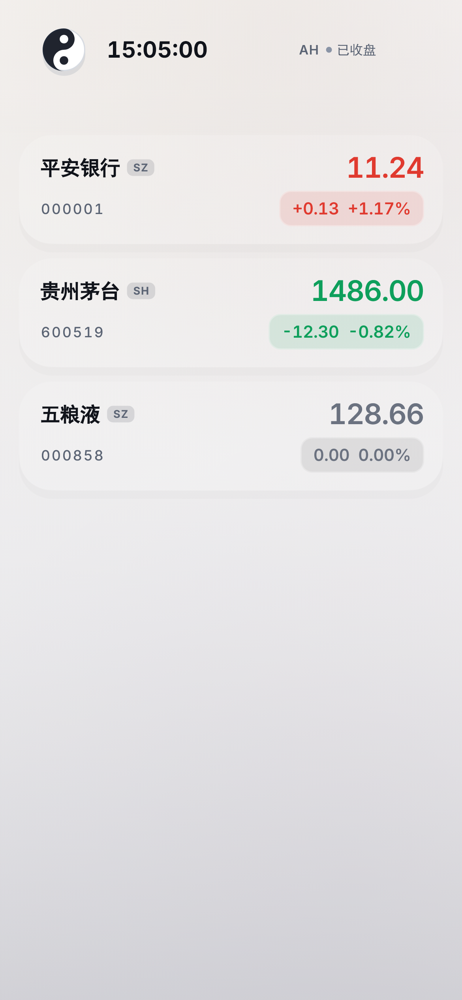
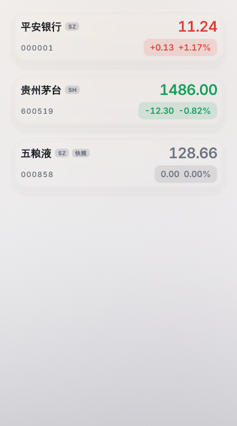
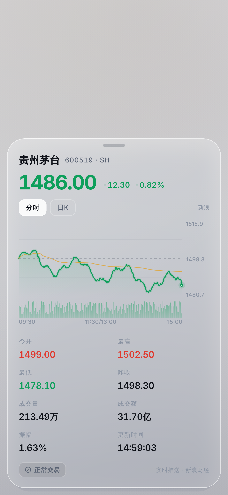
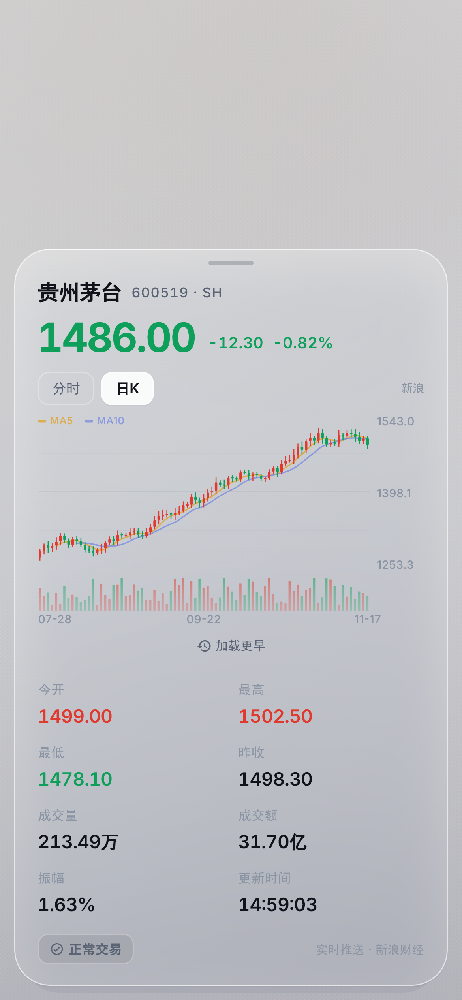
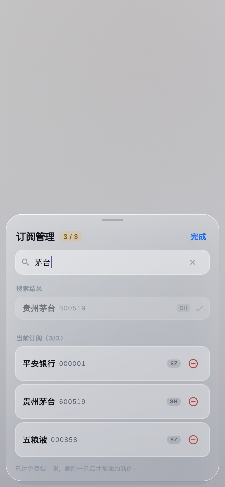

# A 股实时行情（个人自用 MVP）

## 当前状态（2026-11-04）

> 本文是**开发日志**：二·X 各章按时间记录迭代，包含大量已移除的历史形态。
> 「当前怎么跑 / 文件在哪 / 门禁是多少」一律以本节和源码为准。

| 项 | 当前值 |
| --- | --- |
| 项目 / 包名 | `super_market` / `com.example.super_market`（`android/app/build.gradle.kts:10,28`） |
| 技术栈 | Flutter 3.47.9 / Dart 3.13.7，仅 Android，compileSdk / targetSdk 37 |
| 行情链路 | 新浪主 + 腾讯备，3s HTTP 轮询；**零凭证、无 WebSocket、无 iTick** |
| 门禁 | `flutter analyze` 0 issues；`flutter test` **290 通过 + 0 skip**（含 5 张 golden 视觉基线、3 条像素级对比度断言、4 条 3.0x 用例、18 条报价新鲜度用例） |
| 日志 tag | 原生 `super_market`（`MainActivity.kt`）；Dart `debugPrint` 走 `flutter` |
| 帧数据 | `tool/measure_frames.sh`（profile 包 + `PERF_LOG` → `FrameTiming`）；`dumpsys gfxinfo` 对 Flutter 自绘恒为 0 帧 |

**下文仍会出现、但已移除的形态**：iTick WebSocket / REST 收盘快照、`AppConfig.token`、
Token 提示条、`n/3` 配额卡、页脚说明胶囊、下拉刷新与右上角刷新按钮、连接状态胶囊，
以及 `quote_ws_service.dart` / `quote_parser.dart` / `quote_snapshot_client.dart` /
`source_switch_test.dart` 等文件。读到这些词一律理解为「当时」。

**已知缺口**
- **视觉基线与截图是两套东西**：`test/preview/app_preview_test.dart` 生成
  `test/preview/goldens/*.png`（6 张，390×844，进 `flutter test` 门禁）；
  `docs/preview/*.png` 是 iTick 时代的历史截图（含「3 / 3」「实时推送」等已不存在的文案），
  **只作历史对照，不是基线**。两者不要互相覆盖。
- golden 的保真度边界：`flutter_tester` 不支持 Impeller，玻璃走 BackdropFilter 降级路径，
  对布局/字号/颜色/信息层次有决定性，对**玻璃光学的像素级还原**没有——真机观感仍需人工走查。
- **没有当前性能基线**：真机离线、缺 `app-profile.apk`。`tool/perf_baseline.dart` 与
  `measure_frames.sh` 的判定/归档框架已就位，但尚未采集到任何新数字；
  已有两组历史实测条件互斥，见 二·五「性能基线台账」。**不得声称更优**。
- **3.0x 动态字体溢出已修（2026-11-05）**：详情弹层两个 Row 原本右溢 283 / 940 px、
  订阅弹层右溢 155 px，现在 0 溢出且**0 截断**（新增逐条 `didExceedMaxLines` 与
  `FittedBox` 缩放比断言）。两条 skip 已移除，见 二·二十六。代价：极端倍率下布局会重排
  （八宫格单列、名称与代码堆叠），1.0x 的 6 张 golden 逐字节未变。
- **A05 / A10 已完成（2026-11-05）**：小字对比度实测从 1.94:1 提到 **≥4.71:1**，
  图表补了可见的区间摘要、八宫格补了方向词。代价是调色板与弹层面板不透明度都改了，
  见 二·二十五。（区间摘要同日又整体移除，见 二·三十一；方向词保留。）
  **剩余**：A02（深色模式缺失）、A08（液态玻璃用在内容层，产品决策）。
- **「快照 / 实时」判定已改为看时间戳（2026-11-05）**：原来读 `Quote.source`，而
  `QuoteSource.snapshot` 全仓库零构造点，页脚永远说「实时推送」。现在按
  `isStale(quote, now)` 判定，见 二·二十七。随后补齐了三处收尾（二·二十八）：
  跨过判决线自动翻转、「更新时间」跨天补日期、页脚文案改成「轮询更新」。
- 二 的目录树、二·六 功能清单、九 的验证表是早期快照，见各节开头的校正说明。

Android 单平台、只做「前台盯盘」的极简行情 App：**新浪财经为主、腾讯财经为备**，3 秒一轮
HTTP 轮询、`Referer` 换 GBK 明文；3 只股票（可在 App 内改）；每只股票一个
`ValueNotifier<Quote>` 做局部刷新。没有后台保活、没有前台服务、没有状态管理库、**不需要 API Key**。

点开任意一只，除了八项指标，还有一块自绘的分时 / 日 K 走势图（无第三方图表库）。

切到公开源之前的形态是一条 iTick WebSocket + REST 收盘快照。**这套代码已于 2026-11-04
整体删除**（「移除 iTick 通道」），下文 二·九 / 二·十一 里「保留 iTick，随时能切回」
的说法已不成立，仅作历史记录。当时的树摇证据见 **十、release 包里已经没有 iTick**。

## 一、iTick 协议事实（历史资料：通道已删除，不可切回）

> 现在跑的是新浪 / 腾讯，日常改动看 **二·十**、**二·十一**。
> 这一节记录的是 iTick 的协议事实与踩坑，只在切回 iTick 时才需要读。

以 iTick 官方文档 <https://docs.itick.org/websocket/stocks> 为准，本项目按文档实现：

| 环节 | 实际协议 |
| --- | --- |
| 连接地址（**免费档**） | `wss://api-free.itick.org/stock`（切回 iTick 时用它） |
| 连接地址（付费档） | `wss://api.itick.org/stock` |
| 认证方式 | **握手 HTTP Header `token: <你的Token>`** |
| 连接成功 | 服务端下发 `{"code":1,"msg":"Connected Successfully"}` |
| 认证结果 | 服务端**主动**下发 `{"code":1,"resAc":"auth","msg":"authenticated"}`；失败为 `{"code":0,"resAc":"auth","msg":"auth failed"}` 并断开 |
| 订阅 | `{"ac":"subscribe","params":"000001$SZ,600519$SH,000858$SZ","types":"quote"}` |
| 订阅结果 | `{"code":1,"resAc":"subscribe","msg":"subscribe Successfully"}` |
| 心跳 | `{"ac":"ping","params":"1731688569840"}`（当前毫秒时间戳），服务端回 `{"resAc":"pong"}`；1 分钟内无心跳会被断开 |
| 报价推送 | `{"code":1,"data":{"s":"000001","r":"SZ","ld":11.2,"o":11.0,"h":11.3,"l":10.95,"p":11.1,"v":12345,"tu":136780.5,"ch":0.1,"chp":0.9,"ts":0,"t":1731689407000,"type":"quote"}}` |
| 字段含义 | `ld` 最新价、`o/h/l` 今开/最高/最低、`p` 昨收、`v` 成交量、`tu` 成交额、`ch/chp` 涨跌额/幅、`t` 毫秒时间戳、`ts` **交易状态**、`type` 推送类型 |
| `ts` 交易状态 | `0` 正常交易、`1` 停牌、`2` 已退市、`3` 熔断 —— **它不是时间戳**，时间戳是 `t` |

REST（`/stock/quote`、`/stock/list`）那侧的实测事实——**没有批量接口**、每分钟约 4 次就被 429、
`code:0` 也可能是错——单独整理在 **二·八**，那节直接决定了收盘快照的实现形态。

> ### ⚠️ 最容易踩的坑：免费档和付费档是两个不同域名
>
> | 套餐 | REST / WebSocket 域名 |
> | --- | --- |
> | 综合免费套餐 | `api-free.itick.org` |
> | 综合基础 / 专业 / 高级套餐 | `api.itick.org` |
>
> 用错域名的报错是 **`{"message":"Invalid API key in request"}`** ——
> 它和「Key 真的写错了」**一模一样**，所以极容易往错的方向查（换 Key、重置 Key、怀疑复制不全）。
>
> 实测（2026-11，免费档账号，同一个 Key）：
>
> ```
> api-free.itick.org + Key → {"code":0,"data":{"s":"000001","ld":11.54,...}}   ✓
> api.itick.org      + Key → {"message":"Invalid API key in request"}          ✗
> ```
>
> 另外，**免费套餐也要在控制台点一次「立即订阅」才算开通**（不花钱，但必须点）。
> 未订阅时 Key 同样报 `Invalid API key`。这句话值得记：iTick 的「Invalid API key」
> 有三种含义 —— Key 错 / 域名错 / 套餐没开通。
>
> 本项目在 `AppConfig.wsUrl` 里固定用免费档域名，并保留 `wsUrlPaid` 供升级后切换。
> `python tool/check_token.py` 会**自动探测**你的 Key 属于哪一档。

> ⚠️ 重点：**iTick 没有「客户端认证请求帧」**，认证是握手时的 Header。
> 很多第三方教程里的 `{"ac":"auth",...}` 并不是官方 A 股接口的字段，本项目没有编造它。
> 代码里仍保留了 `QuoteWsService.buildAuthFrame()` 这一个出口：默认返回 `null`（走 Header 认证），
> 万一官方将来改成连接后发认证帧，只改这一个方法即可。**具体字段名必须查官方文档确认。**

## 二、目录结构

> ⚠️ 以下是 2026-11-02 的**初始结构快照**。此后经历「切公开源 → 移除 iTick →
> 全面更名 super_market」等多次删改，树中大量文件已不存在（`quote_ws_service.dart`、
> `quote_parser.dart`、`support/mock_source.dart`、旧位置的 `tool/preview/app_preview_test.dart` …），
> 也未列出后加的 `hit_target.dart` / `lifecycle_pause.dart` / `taiji_mark.dart` 等。
> 视觉 harness 已重建，位置改为 `test/preview/app_preview_test.dart`（见 二·五）。
> **以 `lib/`、`test/`、`tool/` 实际目录为准**；保留此树只为记录当时的分层思路。

```
super_market/
├── pubspec.yaml
├── pubspec.lock
├── analysis_options.yaml
├── android/                            # 已生成的 Android 工程（含 INTERNET 权限；release 签名走 keystore.properties，缺失时回退 debug）
├── test/
│   ├── smoke_test.dart                 # 局部刷新 / 列表渲染 / 详情弹层
│   ├── quote_parser_test.dart          # 字段映射、交易状态、退避序列
│   ├── quote_ws_service_test.dart      # 连接状态机（握手/重连/前后台/半开连接）
│   ├── snapshot_watchlist_test.dart    # 收盘快照 / 订阅存档 / 股票目录 / 订阅编辑
│   ├── source_switch_test.dart         # ★ 换个协议跑同一套连接层（接口够不够的判据）
│   ├── polling_source_test.dart        # ★ 新浪 / 腾讯字段映射、单位换算、目录翻页边界
│   ├── polling_feed_test.dart          # ★ 轮询通道：节奏 / 主备切换 / 价格不倒退 / 退避
│   ├── public_source_ui_test.dart      # ★ 首页按通道能力显示（有没有 Key、有没有上限）
│   ├── kline_test.dart                 # ★ 走势解析：O-C-H-L / 手→股 / 跨日切分 / 主备 + 缓存
│   ├── suggest_test.dart               # ★ 搜索解析：市场判据 / B 股 / 北交所 / 去重
│   ├── watchlist_search_test.dart      # ★ 弹层：防抖 / 竞态丢弃 / 失败≠没搜到 / 本地优先
│   ├── kline_chart_test.dart           # ★ 今日那根要不要拼、最后一点要不要跟实时价、横轴映射
│   ├── detail_chart_test.dart          # ★ 详情页走势图：默认分时 / 切日K / 失败可重试
│   ├── backdrop_group_test.dart        # ★ 列表玻璃共享一次背景读取（滚动掉帧的结构防线）
│   ├── scroll_frame_rate_test.dart     # ★ 滑动升 120 / 停手回落 60：边沿触发 + 定时器作废
│   ├── paint_isolation_test.dart       # ★ 内容不是玻璃的子节点（跳价不重跑折射着色）
│   ├── support/mock_source.dart        # ★ 第二个数据源实现：处处与 iTick 相反
│   └── market_session_test.dart        # 交易时段、数字格式化
├── test/preview/app_preview_test.dart  # 视觉基线 harness（在默认测试集里，见 二·五）
│   └── goldens/{page,scroll,detail,detail-daily,watchlist}.png
├── tool/check_token.py                 # 打包前校验 Token + 股票代码（纯标准库）
├── tool/live_probe_test.dart           # 真实服务端 WS 全链路探针（手动跑）
├── tool/source_lag_probe_test.dart     # ★ 双源新鲜度对照（iTick 推送 vs 新浪轮询）
├── tool/polling_live_probe_test.dart   # ★ 真网探针：轮询取价 / 全量目录（抓过 3 个静默 bug）
├── tool/kline_live_probe_test.dart     # ★ 真网探针：K 线两端点 / 是否含当日 / 分时差分
├── tool/search_live_probe_test.dart    # ★ 真网探针：搜索三路命中 / 宽泛词质量 / 目录并发耗时
├── tool/build_apk.sh                   # 一键打包（64 位 + R8 + 剥离符号）
├── tool/verify_apk.py                  # 打包后自检：架构 / R8 / JNI 类 / 包里是哪套数据源
├── tool/measure_frames.sh              # 真机量滑动帧耗时（profile 包 + logcat 探针）
├── tool/pngdiff.py                     # 两张 PNG 的像素级差异对比
├── docs/preview/*.png                  # 预览图（page / cards / detail / detail-daily / watchlist）
├── README.md
└── lib/
    ├── main.dart                       # 入口：edge-to-edge、透明 Scaffold、主题
    ├── config/app_config.dart           # ★ Token / 默认股票 / 节流与心跳退避（协议项已迁出）
    ├── models/quote.dart                # 行情模型 + 涨跌方向 + 交易状态 + 来源 + 合并规则
    ├── models/kline.dart                # ★ 走势模型：Kline / IntradayPoint / KlineResult
    ├── services/
    │   ├── quote_feed.dart              # ★ 传输层接口：9 个成员，页面只认它
    │   ├── quote_feeds.dart             # ★ 当前生效的通道（换传输方式只改这一行）
    │   ├── polling_quote_feed.dart      # ★ 轮询通道：3s 节奏 + 主备切换 + 退避 + 防价格倒退
    │   ├── quote_ws_service.dart        # 推送通道：连/断/退避/半开连接，**不含任何协议字段**
    │   ├── source/
    │   │   ├── symbol_catalog.dart      # ★ 身份 + 代码目录（推送/轮询共用），含 CatalogPage
    │   │   ├── market_data_source.dart  # ★ 推送协议接口：6 组可变点 + FrameKind
    │   │   ├── itick_source.dart        # ★ iTick 实现（地址/握手/帧/信封/字段全在这）
    │   │   ├── market_data_sources.dart # iTick 实例（推送路径用）
    │   │   ├── polling_source.dart      # ★ 轮询协议接口：批量地址 + 请求头 + 原始字节解析
    │   │   ├── sina_source.dart         # ★ 新浪实现（主力）：GBK / 字段数不固定 / 翻 70 页
    │   │   ├── tencent_source.dart      # ★ 腾讯实现（备份）：手→股、万元→元 的换算在这
    │   │   ├── polling_sources.dart     # ★ 报价主备顺序（调换两行即可换主力）
    │   │   ├── kline_source.dart        # ★ 走势协议接口：日线地址 / 分时地址 / 两个解析
    │   │   ├── sina_kline.dart          # ★ 新浪走势（主力）：scale=240 日线、scale=1 分时
    │   │   ├── tencent_kline.dart       # ★ 腾讯走势（备份）：O-C-H-L 顺序 + 手→股 + 累计量差分
    │   │   ├── kline_sources.dart       # ★ 走势主备顺序（与报价分开，能力不同不共享列表）
    │   │   ├── symbol_search.dart       # ★ 搜索协议：地址 / 请求头 / 字节→候选
    │   │   ├── eastmoney_suggest.dart   # ★ 搜索主力（东财）：MarketType 判市场 + 号段挡 B 股
    │   │   └── symbol_searches.dart     # ★ 搜索当前实现（换源改一行）
    │   ├── kline_loader.dart            # ★ 走势取数：主备切换 + 30s 缓存 + 失败不抛
    │   ├── quote_parser.dart            # iTick 字段映射（ItickSource 的实现细节）
    │   ├── quote_snapshot_client.dart   # ★ 非交易时段的收盘价来源（REST，串行 + 节流）
    │   ├── rest_client.dart             # HTTP 传输层：状态码 / 响应体 / 默认 dart:io 实现
    │   ├── watchlist_repository.dart    # 订阅列表的本地存档（读写都兜底，坏了退回默认）
    │   ├── symbol_directory.dart        # ★ 代码↔名称目录，一次性缓存约 195KB，搜索全离线
    │   ├── local_store.dart             # KeyValueStore 接口 + 文件实现 + 内存实现
    │   └── reconnect_backoff.dart       # 指数退避（可选等抖动）
    ├── pages/quote_list_page.dart       # 列表页 + 生命周期 + 玻璃头部/配额卡/底部胶囊
    ├── widgets/
    │   ├── glass.dart                   # ★ 液态玻璃材质：极光背景 + GlassPanel
    │   ├── quote_tile.dart              # 玻璃行情卡，内部 ValueListenableBuilder
    │   ├── quote_detail_sheet.dart      # 行情详情：走势图 + 今开/高低/昨收/量额
    │   ├── kline_chart.dart             # ★ 自绘走势图（分时折线 + 日 K 蜡烛 + 量柱），无第三方库
    │   ├── watchlist_sheet.dart         # ★ 订阅管理弹层：搜索添加 / 删除 / 配额提示
    │   ├── market_session_badge.dart    # 交易时段角标（按订阅市场并集）
    │   └── taiji_mark.dart              # 圆形太极徽标：交易中缓转、非交易静止（二·十四）
    └── utils/
        ├── app_log.dart                 # 统一日志前缀
        ├── format.dart                  # 价格/涨跌/万·亿/时间 格式化
        ├── frame_rate.dart              # ★ 滑动升 120 / 停手回落 60（按需投票）
        ├── perf_probe.dart              # 帧耗时探针（只在 PERF_LOG 构建里跑）
        └── market_session.dart          # ★ A 股 / 港股时段判断 + 订阅并集（纯函数）
```

## 二·五、视觉：液态玻璃（Liquid Glass）

| 首页（收盘后：价格来自快照） | 有行情的卡片 | 行情详情弹层 | 订阅管理 |
| --- | --- | --- | --- |
|  |  |  |
|  |  | |


App 图标（右图）：**白底负空间虎鲸**——白色圆底 + 海蓝（`#2F86D6`）鲸鱼
剪影，眼斑/腹月牙/嘴线全部是**镂空负空间**（透出白底），整个图标只有两种
颜色。对齐用户提供的参考 logo（白底 + 蓝鲸 + 白色负空间）与 DeepSeek 的
极简语言；48px 下剪影与镂空全部可辨。

演进轨迹：白色 W 矢量 → 幽灵鲨（红底）→ 红底虎鲸 → 深蓝虎鲸 → 海蓝渐变
虎鲸（多色分层）→ **白底负空间虎鲸（当前）**。图标由
`tool/icongen/IconGen.java`（Java2D）渲染，`tool/icongen/regen.sh`
一条命令重生成全部 6 个资源；几何与配色的取舍（含尾巴的七轮迭代记录）
都写在生成器的类注释里。

| 层 | 资源 |
| --- | --- |
| 背景 | `@android:color/white`（系统白，负空间透出的就是这片白） |
| 前景 | `drawable-nodpi/ic_launcher_foreground.png`（432px 位图）：鲸剪影 + DstOut 镂空一次成型 |
| 主题图标 | `monochrome` 复用前景（系统只取 alpha 当遮罩再上色，鲸剪影含镂空洞正好是完整轮廓） |

> 低版本回落：Android 7.x（`minSdk 24`）不认 `mipmap-anydpi-v26`，走
> `mipmap-*/ic_launcher.png` 五档（48/72/96/144/192），同一生成器的
> `legacy` 模式渲染（白圆底 + 白墨负空间），与自适应图标同源同色。

风格取自 Apple 2025 的 Liquid Glass 语言，落到 Flutter 上是三件套：

| 层次 | 实现 |
| --- | --- |
| 背景 | `AuroraBackground`：中性竖向渐变（F8F6F5 → EFEEEF → DCDBDE）+ **去饱和的雾团**（金/珊瑚在上、粉在右腰、紫/蓝紫在下，**无绿色**——绿在本 App 专属「跌」）+ **18% 白纱**压成磨砂。v8 起连做两次减法：每个色团朝自己灰度插值 **80%**、alpha **×0.30**，底色彩度收到 3/1/1，再盖白纱抬亮整块背景——只降饱和会「又淡又脏」，只降 alpha 会「色相还在只是变灰」，两者加白纱一起才从「彩色雾」变成「色温」。色值都是从**原始饱和色**重算，不在上一档结果上再叠（那样等于减两遍，会把金/珊瑚压到和冷色同亮度，顶部光源方向就没了）。降的量有下限：再淡就回到「纯中性灰、玻璃无物可折」的死路（v2 验证过）。 |
| 面板 | `GlassPanel`：`BackdropFilter(ImageFilter.blur)` 磨砂 + 白 55%→24% 对角渐变 + 1px 发丝描边 + **顶部 1px 镜面高光** + **底部 1px 环境反射** + 斜向眩光 + 柔和外阴影。 |
| 结构 | 悬浮胶囊头部（太极标识 / 秒表时钟，见 二·十四；连接状态胶囊与刷新按钮已按产品要求移除——断链时轮询链自己换源重连）、玻璃行情卡（28 圆角）、配额卡、底部说明胶囊；`Scaffold` 透明 + `edgeToEdge`，让极光铺到状态栏后面。 |

字号与细节：价格 24 / w600 / `letterSpacing -0.6` / 等宽数字（`FontFeature.tabularFigures()`，跳动不左右抖）；涨跌胶囊 14（用户反馈后从 28/12 调到 24/14，主次分明又不失衡），**贴右缘、在价格正下方**（Expanded 而不是 Flexible——Flexible 的盒子只有内容宽，胶囊会「漂」在卡片中部，实测 golden 里差 38px）；
名称 17 / w600；代码 12 / 字距 1.2 更「终端感」；涨跌胶囊底色是同色 12% 透明度。

想调风格只改两个文件：`lib/widgets/glass.dart`（模糊半径 `blur`、玻璃透明度 `tint`、极光色板）和
`lib/pages/quote_list_page.dart`（头部/配额卡/底部）。改完跑视觉基线：

```bash
flutter test test/preview/app_preview_test.dart                  # 比对（门禁里已包含）
flutter test test/preview/app_preview_test.dart --update-goldens # 确认改动符合预期后重出基线
# 产物：test/preview/goldens/{page,scroll,detail,detail-daily,watchlist}.png
# 失败对比图落在 test/preview/failures/（已 gitignore）
```

harness 用**全注入**写法（完整清单见该文件头注释）：假 `QuoteFeed`（固定价位 +
14:59:03 时间戳）、假 `SymbolDirectory`、假 `KlineLoader`、`MemoryKeyValueStore` 存档、
钉死时钟 `2026-11-05 15:05`（A 股已收盘、港股盘中，角标按订阅并集显示「交易中」）——
假 feed 只推一帧、太极由行情 tick 驱动所以不自转，任何一帧都可复现。字体必须显式加载：
Inter 走仓库资产，中文回退 SimHei（`C:/Windows/Fonts/simhei.ttf`，可用 `PREVIEW_CJK_FONT`
覆盖），图标字体取 Flutter SDK 缓存；缺任何一个都会渲染成方框。

> **为什么放在 `test/` 而不是 `tool/`**：`flutter test` 默认只扫 `test/`。旧 harness 在
> `tool/preview/` 时从来不在门禁里跑，脚本被删掉后没人发现，六张图静默过期（A13）。
> 现在它在 `test/preview/`，每次门禁都会执行，改坏了当场变红。
>
> `docs/preview/*.png` 是 iTick 时代的历史截图（上方效果图仍引用它们），
> **不是 golden 基线**，harness 不会覆盖它们。

### 滚动掉帧：一次只拷一遍整屏（`GlassBackdropGroup`）

#### 性能基线台账（先读这个，A14）

`tool/perf_baseline.dart` 给每条记录生成 `baselineKey = device / build / scenario / hz`，
**只有 key 完全相同才可比**。判定只依据官方帧预算 `1000/hz`，jank 只记录不判定；
没有同条件基线时不声称「更优」。

| 记录 | device | build | hz | 场景 / 样本 | 实测 | 可信度 | 不能和谁合并 |
| --- | --- | --- | --- | --- | --- | --- | --- |
| 滚动帧·修复前 | PLJ110 | profile | 90 | 滑动 5 次 / 40 帧窗口 | build p50 1.0 · max 3.3 ms；raster p50 11.7 · p90 12.2 ms；40/40 掉帧 | 中：历史版本，结构前提（页头 premium 玻璃、每帧 15 次全屏拷贝）已不存在 | 与下一行跨刷新率、跨结构 |
| 滚动帧·分组后 | PLJ110 | profile | 120 | 滑动 5 次 / ≈570 帧 | build p50 0.8~1.2 · max 2.6 ms；raster p50 4.6 · p90 5.6 ms；0~1 掉帧 | 中：历史版本，之后卡片玻璃参数又调整过 | 与上一行跨刷新率、跨结构 |
| 冷启动 / 内存 | OPPO Find X9 | release | — | 3 次冷启动 / 静置 30s | TotalTime 354 / 308 / 320 ms（中位 320）；首帧 +329ms；首帧→首报价 68ms；PSS 134MB → 后台 81MB / CPU 0% | 高：3 次采样、设备与构建齐全 | 与前两行跨设备、跨构建、指标不同 |

**当前没有新基线**：采集需要设备 + 带 `PERF_LOG` 的 `app-profile.apk`，本轮二者都不具备。
复采：`flutter build apk --profile --target-platform android-arm64
--dart-define=PERF_LOG=true` → 插上手机 → `./tool/measure_frames.sh`，
结果落在 `build/perf/baseline-*.json`（原始日志 `build/perf/perf-*.log`）。
脚本退出码 `0`=通过 / `1`=判定失败 / `2`=不可测（没采到 `[perf]` 样本，
常见原因是自选不足一屏，滑动根本没产生帧——**不可测 ≠ 合格**）。

**仍无同条件基线的场景**（不得声称更优）：自选超过一屏时的滚动、玻璃卡数量增长后的
raster、K 线 240 根绘制、盘中 3s 跳价时的刷新帧率、能耗 / 长时内存增长；
以及 **60Hz 档**——当前「滑动升 120、停手 60 且静止不产生帧」，该档滚动帧采不到，
需先改投票策略（属产品决策）。换场景时用 `SCENARIO=...` 区分，避免 baselineKey 撞车。

仪表数据（PLJ110 / Android 17 / 90Hz / profile 包，滑动 5 次）：

| 指标 | 修复前 | 分组后（120Hz 实测） | 预算（120Hz） |
|---|---|---|---|
| build（UI 线程）p50 / max | **1.0 / 3.3 ms** | 0.8~1.2 / 2.6 ms | 8.33 ms |
| raster（GPU）p50 / p90 | **11.7 / 12.2 ms** | **4.6 / 5.6 ms** | 8.33 ms |
| 掉帧帧数 | **40 / 40** | 0~1 / 40（≈570 帧里 1 帧） | — |

raster 从 11.7ms 降到 4.6ms（−61%）——**这不是同条件 A/B**：前者是 90Hz / 修复前
（页头仍是 premium 玻璃、每帧 15 次全屏拷贝），后者是 120Hz / 分组后。
设备与构建虽同为 PLJ110 / profile，但**刷新率档和被测结构都变了**，所以这个百分比
只能说明「改完之后在 120Hz 的 8.33ms 预算下有余量」，**不能作为量化基线或「更优」的证据**
（见上面的台账）。顺序结论仍然成立：必须先吃掉玻璃分组的开销再升 120Hz，
否则就是「更低预算 + 同样的耗时」。
唯一的例外是冷启动后的**第一次滑动**：曾观测到一帧 100.5ms 的尖峰（纹理上传 /
首帧预热），之后再滑就没有了。

build 只有 1ms，说明**不是重建问题**；GPU 稳定压在 11.7ms、恰好越线，是典型的
「每帧拷贝整屏次数过多」。包里文档写得很直白：

> On Impeller every `BackdropFilter` ends the render pass and copies the whole
> screen, however small the glass, and premium glass has two of them per surface
> (three with the iOS 27 frost).

四张卡片 + 页头全是 `premium` → 每帧 **15 次全屏拷贝**。修法是把列表包进
`GlassBackdropGroup`，组内玻璃共享**一次**背景读取：

- 页头**故意不进组**：它得透过自己看见从底下穿过的卡片，进组就会读到「卡片尚未
  绘制」的那一遍背景，卡片在页头里直接消失；
- `test/backdrop_group_test.dart` 守着这两条不变量之一（组存在 + key 相同），
  去掉组会立刻变红——`Found 0 widgets with type "GlassBackdropGroup"`。

> 量帧用 `lib/utils/perf_probe.dart`：`--dart-define=PERF_LOG=true` 的构建会在
> logcat 打 `[perf] hz=90 budget=11.11 build(...) jank=N raster(...) jank=N`，
> 默认构建里它一行都不跑。**预算不写死**：同一台机器会在 60/90/120 档之间切换，
> 写死 11.11ms 的话换到 120Hz（8.33ms）后掉帧会被判成合格。也不能用
> `dumpsys gfxinfo`——Flutter 自绘，HWUI 统计不到它的帧（reset 后滑一次，
> `Total frames rendered: 0`）。

### 120Hz：按需投票，不是一直钉最高档

面板支持 120Hz，但 App 之前**跟着系统走**，实际跑在 90Hz（`SurfaceFlinger`
报的刷新周期 11111111ns）。Flutter 自己不限制帧率，它跟着 Choreographer 的
vsync 走，所以「能不能 120」取决于三件事：面板有没有这个 mode、系统/OEM 策略
允不允许本应用升档、应用有没有提出请求。

第三件由 `lib/utils/frame_rate.dart` + `MainActivity.kt` 一起做，**只在滑动期间
升档**：

| 时机 | 动作 |
| --- | --- |
| 开屏 / 停手 800ms 后 | 投 60Hz，`FIXED_SOURCE` |
| `ScrollStartNotification` / 滚动更新 | 投 120Hz，`DEFAULT` |
| 连续滚动 | 不重复投（边沿触发，一次滑动一次票） |

两档用不同的 compatibility，这是有意的：升档用 `DEFAULT`，撑不住时系统可以退成
60 重帧，比强撑 120 的 judder 好看；回落必须用 `FIXED_SOURCE`，否则 60 是 120 的
约数，系统完全可以「继续 120，只是重帧」——那就白回落了。

四个坑，都踩过：

- **`Window.setFrameRate` 不存在**。这个 API 在 `Surface` 上（API 30+），必须拿到
  Flutter 正在呈现的 `FlutterSurfaceView.holder.surface`。拿不到（TextureView
  模式、还没 attach）才退回 `window.attributes.preferredRefreshRate`。
- **`ScrollEnd` 后面紧跟一条 `UserScrollNotification(idle)`**。把后者当「又开始
  滑了」，就会把刚排上的回落定时器取消掉——回落永远不发生，档位永远停在 120。
  真机上表现为「说好省电、结果一直高刷」，是 `test/scroll_frame_rate_test.dart`
  抓出来的。
- **只在当前分辨率内挑刷新率**。不少 LTPO 面板把 120Hz 放在低一档分辨率上
  （1440p@90 / 1080p@120 并存），`maxByOrNull { it.refreshRate }` 会顺手把分辨率
  降下来——刷新率上去了，字变糊了。
- **两套机制不能并用**。早先版本在 `onCreate` 里固定 `preferredDisplayModeId`，
  那是「钉住显示模式」，和帧率投票是两套信号，同时存在时听谁的取决于 ROM 实现，
  无法复现。所以 API 30 以上只走投票，固定 mode 只留给没有 `setFrameRate` 的旧系统。

**顺序很重要**：120Hz 的帧预算是 8.33ms。修复前 raster 是 11.7ms——连 90Hz 都
撑不住，直接升 120 只会让掉帧更明显，所以先做上面的 `GlassBackdropGroup`，
再谈刷新率。

实测用 `./tool/measure_frames.sh`：装 profile 包 → 抓 `refresh:` 与 `[perf]` →
`dumpsys display` 确认当前 mode。日志会自己列出面板全部档位。

真机实测（PLJ110 / Android 17）：

```
refresh: 当前=120.00001Hz (1256x2760, modeId=1); 全部档位=
    1256x2760@120.00001, 1256x2760@90.0, 1256x2760@60.0,
    1080x2374@120.00001, 1080x2374@90.0, 1080x2374@60.0
refresh: 投票 60Hz  fixed=true  -> 60.0Hz  (modeId=3)   ← 冷启动 / 停手 800ms
refresh: 投票 120Hz fixed=false -> 120.00001Hz (modeId=1) ← 开始滑动
[perf] hz=120 budget=8.33 n=40 build(p50=0.8 ...) raster(p50=4.5 p90=5.3 max=5.8) jank=0
```

注意面板的两套 mode：同一块屏 1256×2760 和 1080×2374 各有 120/90/60 三档。这就是
必须按分辨率过滤的实据——不过这台的 120 在原生分辨率上，不会踩到降分辨率。

`dumpsys display` 里 `mOverrideDisplayInfo` 的 `renderFrameRate` 会跟着变（空闲 60、
滑动 120），而 `mActiveModeId` 仍停在系统的 90——这是 Android 11+ 的设计：按窗口投票，
显示模式跟着顶部应用走，不是把整块屏钉死。

## 二·六、功能清单（点开卡片能看到什么）

> ⚠️ 本节写于 iTick 推送时代。**走势图 / 八项指标 / 时段角标 / 卡片 `Semantics` 播报 /
> 大屏限宽 560 仍在**；下表列出已被改掉的部分，以源码为准：
>
> | 历史表述 | 当前实际 |
> | --- | --- |
> | 下拉刷新 + 右上角刷新按钮 | **均已删除**；`test/header_fade_test.dart` 断言无 `RefreshIndicator`，断链由轮询链自动换源重连 |
> | Token 未配置 / 认证失败 / 订阅超额 红色提示条 | 通道零凭证，该提示条已删；错误条只在 `lastError` 非空时出现（「行情源暂时都不通…」） |
> | 配额卡 `n / 3`、页脚说明胶囊 | **均已删除**（公开源不限只数，页脚已移除） |
> | 换订阅＝「断开重连并重新订阅」 | 轮询无长连接；现在是 `PollingQuoteFeed.updateStocks` 直接换标的 |
> | 大字体 >1.3 倍自动切「上下三行」 | `_StackedLayout` 与阈值已删，只剩名称↔价格、代码↔涨跌胶囊一种两行布局（省略号 + `FittedBox` 兜底） |
> | 每张卡 `Semantics` 播报 | 仍在；A01 另加 `HitTarget` 把 7 处小控件触控目标扩到 48×48dp，布局占位不变 |
> | 自绘 K 线图 | 仍在，且 A12 修掉截断响应被当成功的静默失败（见 `test/truncated_response_test.dart`） |
>
> 下文「同一条 quote 推送」「免费档 1 连接 3 订阅」同样是当时的说法。

点任意一张行情卡 → 液态玻璃详情弹层，数据全部来自**同一条 quote 推送**，
不新增任何订阅（免费档「1 连接 3 订阅」额度一分没多花）：

| 块 | 内容 | 说明 |
| --- | --- | --- |
| **走势图** | 分时 / 日K | 自绘，无第三方图表库；最后一个点/最后一根用实时价补，避免「头部在跳、图上不动」。两个 tab 的图表区块**完全等高**（图 182px，图下无文字），切换时指标区不位移；日 K 固定 80 根，不再提供「加载更早」入口（见 二·三十） |
| 今开 / 最高 / 最低 | `o` / `h` / `l` | 相对昨收自动上色（高=红、低=绿） |
| 昨收 | `p` | 同时用于推算涨跌额/幅与振幅 |
| 成交量 / 成交额 | `v` / `tu` | 压缩成「万 / 亿」，避免一串数字读不出量级 |
| 振幅 | 计算值 | `(高 - 低) / 昨收 × 100%`，不依赖额外字段 |
| 更新时间 | `t` | 弹层开着时也继续实时跳动 |
| 交易状态 | `ts` | 停牌 / 已退市 / 熔断会在卡片与弹层双处提示 |

**交互与容错**

| 交互 | 行为 |
| --- | --- |
| 点击卡片 | 弹出行情详情（见上表），弹层开着时数值继续实时跳动 |
| 下拉刷新 | 重新连接 + 重新订阅，转圈在「已连接」或 6s 超时后自动收起（不会一直转） |
| 右上角刷新按钮 | 同上，给不习惯下拉的人留一条路；已连接时置灰 |
| 致命错误 | Token 未配置 / 认证失败 / 订阅超额 会在头部下方弹一条红色玻璃提示，**直接说人话 + 带「重试」按钮**，成功后自动消失 |
| 无障碍 | 每张卡片带 `Semantics` 播报（名称、代码、最新价、涨跌方向与幅度、更新时间），涨跌不只靠颜色传达 |
| 大屏 | 内容区限宽 560，平板/横屏不会把一行拉成一条 |
| 大字体 | 系统字体放大超过 1.3 倍（或宽度 < 300dp）时，行情卡自动从「左右两列」切成「上下三行」，价格与涨跌胶囊套 `FittedBox` 兜底——**实测 1.5 倍字体 + 320dp 原本溢出 48px**，现在零溢出（见 `test/layout_robustness_test.dart`） |

**交易时段角标**（头部「AH」后面）：`未开盘 / 集合竞价 / 交易中 / 午间休市 / 已收盘 / 休市`。

判定按**订阅市场的并集**（`MarketSession.ofRegions`，与太极同口径）：纯 A 股自选
15:00 收盘，混合 A+H 时港股交易到 16:10，A 股 15:00 后角标仍写「交易中」；
11:30–12:00 A 股午休但港股早市未收，也写「交易中」。只有全部订阅市场都休市
才写「已收盘」。详见 **二·二十九**。

为什么需要它：行情只在有成交时变化，收盘后价格自然不动。如果界面只写「已连接」，
看到价格静止会以为卡死；写清时段才是对静止数据的正确解释。
角标自己持有 30s 定时器，只在时段真的跨过边界时才 `setState`，不牵连列表；
订阅列表一变（例如刚加了一只港股）`didUpdateWidget` 当场重判，不等定时器。

> ⚠️ 已知限制：只判断「工作日 + 时段」，**没有接法定节假日日历**。
> 春节、国庆这类工作日休市会显示成「交易中」。这属于课程范围之外的数据源（需要交易日历接口），
> 需要的话在 `AppConfig` 里加一张节假日表，改 `MarketSession.of()` 一处即可。

## 二·七、订阅管理（换股票不用改代码）

配额卡右侧有个「管理」小胶囊 → 液态玻璃弹层（`lib/widgets/watchlist_sheet.dart`）：

| 能力 | 实现 |
| --- | --- |
| 搜名称/拼音 | 输入即搜：**本地目录命中优先**，同时 250ms 防抖查一次远端建议（170–380ms），两路合并去重。支持全拼 `gzmt` → 贵州茅台 |
| 搜代码添加 | 精确代码排最前；`000001` 沪深各一只，两行都会列出来（带 `SH`/`SZ` 角标） |
| 目录没下完 | **不阻塞**：搜索走远端，目录在后台并发预热（7 秒左右，见二·十三） |
| 按代码兜底 | 6 位数字直接给一行「按代码添加」，用代码前缀推断市场（网络全挂也能加） |
| 删除 | 每条右侧减号，**至少保留 1 只**（否则界面是空的） |
| 配额 | 标题旁 `n / 3`，满 3 变琥珀色；已订阅的行置灰并显示 ✓ |
| 生效方式 | 点「完成」→ 写本地存档 → 服务层**断开重连并重新订阅** → 只给「还没有价格」的补一次快照 |

三个非显然的设计决定：

1. **存档优先于编译期常量**。`AppConfig.stocks` 现在只是「首次安装的默认值」，
   用户改过之后以 `watchlist.v1` 存档为准；存档读坏 / 读不到（权限、平台通道异常）
   一律退回默认三只，绝不让首页起不来。
2. **换订阅是「断开重连」，不是「再发一条 subscribe 帧」**。iTick 没说明 subscribe 是
   替换还是追加语义；若是追加，删一只再加一只就变成 4 个订阅，直接撞免费档上限。
   重连是唯一行为确定的做法，代价只是一次约 1.5s 的握手。
3. **notifier 的键带市场**（`code$region`）。`000001` 在深市是平安银行、沪市是上证综合指数，
   只按代码做键会把两只不同标的挤进同一张卡。

**本地股票目录还要不要**：要，但它不再是搜索的**前提**。远端建议接口
（`searchapi.eastmoney.com`，见二·十三）已经能做到输入即搜，目录的价值退化成两条：
**没网时也能搜**、**命中时零延迟**（不用等 200ms 的往返）。所以下载放在后台并发预热，
搜索结果由「本地命中 + 远端结果」合并去重，用户感觉不到目录在不在。

顺带纠正一条早期结论：iTick 的 `/stock/search` 实测返回 `Interface exception`，
当时据此写成「各家都没有关键词搜索能力，只能整份拉下来」。**这个判断是错的**——
新浪、腾讯、东方财富都有搜索建议接口，只是不在文档里。真网探针能纠的错，比单测多。

## 二·八、非交易时段：收盘价 + 涨跌幅（原「· 快照」标注，见 二·三十二）

iTick 的 WebSocket **只在有成交时推送**。收盘后、开盘前、午休都可能几十秒一条都不来，
界面就一直是 `--`。所以启动时和回前台时额外走一次 REST `/stock/quote` 补数据。
~~卡片名称行带「快照」小角标（时间行已删，见 二·十四），详情弹层底部也会写「收盘快照 · iTick」。~~
**2026-11-05 用户拍板：界面不再显示「快照」字样**——卡片角标整体移除，详情页脚
stale 时只留来源名（见 二·三十二）；「已收盘 vs 卡住了」由页头交易时段角标交代。

> 为什么必须标注来源：只有一个静止的数字，用户无法区分「已收盘」和「卡住了」。
> 标上来源，静止就有了正确的解释（再配合头部的交易时段角标）。

**REST 实测边界**（2026-11，免费档，这些结论直接决定了实现形态）：

| 事实 | 实测结果 | 后果 |
| --- | --- | --- |
| 批量查询 | `code=000001,000858` → `data:null`；`codes=` → `The 'code' parameter is missing` | **不支持批量**，3 只股票 = 3 个请求 |
| 限额 | 同一分钟第 5 个请求起返回 `{"error_msg":"{\"code\":429,...}"}`（错误被多包一层字符串），60s 后恢复 | 本地强制 60s 节流，**绝不轮询** |
| 错误代码 | 返回 `{"code":0,"msg":null,"data":null}` | `code:0` **不等于**成功，必须再看 `data` |
| 时间戳 | `t` 为毫秒 | 与 WS 推送同形，可复用 `QuoteParser` |

于是 `QuoteSnapshotClient` 的策略是：**串行 + 每只间隔 250ms + 60s 内不重复拉 + 一遇 429 立刻停手**。
遇到 429 是 `break` 而不是 `continue`——继续撞只会让恢复更慢。

**快照 vs 实时谁覆盖谁**：快照是异步返回的，可能比 WS 推送晚到。无条件覆盖会把
「实时价盖回收盘价」。所以有一个纯函数 `shouldApplyQuote(current, incoming)`（单测覆盖 5 条）：

| 场景 | 结果 |
| --- | --- |
| 当前没数据 | 接受（首屏填充） |
| 快照时间戳更旧 | 拒绝 |
| 快照时间戳更新 | 接受 |
| 同一时刻 | 实时推送优先 |
| 来者没有价格 | 永不覆盖 |

## 二·九、数据源抽象（切到 Infoway / QOS 时改哪里）

先说结论：**「三个函数」是不够的，真实可变点是 6 组 14 处。** 三函数只覆盖了
WS 行情链路那一段，漏掉的三处恰恰是最容易在换源那天翻车的：

| 组 | 原来散落在 | iTick 的写法 |
| --- | --- | --- |
| 鉴权 | `quote_ws_service.dart` | Token 走**握手 Header**，协议里根本没有认证帧 |
| | 同上 | 靠 `resAc:"auth"` 与文案 `Connected Successfully` 判认证 |
| 订阅 | 同上 + `app_config.dart` | `{"ac":"subscribe","params":"000001$SZ,...","types":"quote"}` |
| 心跳 | 同上 | `{"ac":"ping","params":"<ms>"}` / `resAc:"pong"` |
| 解析 | `quote_parser.dart` | `s/r/ld/ch/chp/p/o/h/l/v/tu/ts` 单双字母字段 |
| **REST** | `app_config.dart` / `symbol_directory.dart` / `rest_client.dart` | `/stock/quote`、`/stock/list`、`{"code":0,"data":...}`、目录字段只有 `c`/`n`、429 被包进字符串 |
| **标的写法** | `StockConfig.symbol` | `code$region` |
| **界面文案** | 详情弹层 / 页脚 / 日志 tag / 缓存文件名 | `· iTick`、`itick_state.json` |

于是抽象的不是「三个函数」，而是**五组方法**（`MarketDataSource`）：

```dart
abstract interface class MarketDataSource {
  String get id;                                  // 缓存命名空间 + 日志 tag
  String get displayName;                         // 界面「轮询更新 · XXX」

  // ① 连接与鉴权
  String get wsUrl;
  Map<String, String> handshakeHeaders(String token);
  Map<String, dynamic>? loginFrame(String token);  // null = 协议无登录帧

  // ② 订阅与心跳
  String formatSymbol(StockConfig stock);
  Map<String, dynamic> subscribeFrame(List<StockConfig> stocks);
  Map<String, dynamic> pingFrame(int timestampMs);

  // ③ 收帧分类（连接层只认这 8 个语义，不认 resAc / event / op）
  FrameKind classify(Map<String, dynamic> json);
  String? errorText(Map<String, dynamic> json);

  // ④ 推送解析（推送帧与 REST data 的包裹层通常不同，所以是两个方法）
  List<Quote> parseQuotes(Map<String, dynamic> json);
  Quote? parseQuotePayload(Object? data, {required StockConfig stock});

  // ⑤ REST
  List<String> get markets;
  Uri quoteUri(StockConfig stock);
  Uri symbolListUri(String region);
  RestResult decodeEnvelope(HttpJsonResponse res);
  List<StockConfig> parseSymbolList(Object? data, {required String region});
}
```

`FrameKind` 是这套设计的关键一步：`_handleControlMessage` 里那 4 个
`if (resAc == ...)` 变成一次 `switch`，于是**连接层的状态机（握手超时、隐式订阅
成功、fatal 不重连、代数作废旧回调、半开连接判定）一行都不用改**。

### 换源怎么做

改一行：

```dart
// lib/services/source/market_data_sources.dart
static const MarketDataSource current = ItickSource();   // → InfowaySource()
```

自动跟着变的东西：连接地址/凭证方式/登录帧、订阅与心跳帧、收帧分类、推送解析、
快照地址与信封、代码目录地址与字段、详情弹层来源名、日志 tag、本地缓存文件名
（`<id>_state.json`，避免读到上个源格式的目录）。

**唯一要人判断的是配额参数**：`AppConfig.snapshotMinInterval`（60s）、
`restRequestGap`（250ms）是从 iTick「每分钟约 4 次」实测推出来的，换源后必须重新实测。
这些刻意没进接口——它们不是协议事实，是需要你拿真账号去测的数字。

### 为什么能确信接口够用

只有一个实现的接口，本质上是照着一家的报文猜的。所以 `test/support/mock_source.dart`
提供了一个**处处与 iTick 相反**的第二实现：

| 维度 | iTick | MockSource |
| --- | --- | --- |
| 凭证 | Header `token` | Header `X-Api-Key` **且**连上后发登录帧 |
| 握手 | `{"msg":"Connected Successfully"}` | `{"event":"hello"}` |
| 标的 | `000001$SZ` | `SZ:000001` |
| 订阅 | 一条逗号串 | `{"op":"sub","symbols":[...]}` 数组 |
| 推送 | `{"data":{...}}` 单对象 + 毫秒 | `{"quotes":[{...}]}` 数组 + **秒级** |
| 信封 | `{"code":0,"data":...}` | `{"ok":true,"result":...}` |
| 限流 | 429 + 文本 | `{"ok":false,"error":{"code":"rate_limited"}}` |
| 目录字段 | `c` / `n` | `sym` / `name` |

`source_switch_test.dart` 用它跑通同一套连接层、快照、目录。它替掉的是原来
30 多处手写 `'{"code":1,"resAc":"subscribe"}'` 的断言——现在测试断的是
`FrameKind.subscribeOk` 这种**语义**，协议一换不用跟着改。

### 这次重构的判据：70 个旧用例一个没改

改完后 `flutter test` 是 **77 个全绿**（70 旧 + 7 新），`flutter analyze` 干净——
旧的 70 个用例**一行都没动**。这说明行为零变化，也正是「抽象到底改变了什么」最直接的证据。

两处**故意破坏**验证过新用例真的在守门：

1. 把 `FrameKind.handshake` 分支里的 `_sendLoginFrame()` 删掉 →
   「握手 → 登录帧 → 订阅 → 推送」立刻红（iTick 是 Header 认证、没有登录帧，
   所以这条路径**只有换了源才会被走到**，它原来根本不存在）；
2. 让 `ItickSource.classify` 把 `resAc:"auth"` 判成 `unknown` →
   `quote_ws_service_test.dart` 里 6 条用例立刻红。

### 顺带修掉的两个隐性问题

- **notifier 的键原来用的是协议格式**（`000001$SZ`）。数据源一换，键就全变了，
  而键只是「内部身份」——现在 `StockConfig.key` 是 `code@region`，协议写法由
  `formatSymbol` 单独负责。
- **视觉预览的 golden 会随钟点自己失效**：交易时段角标读的是墙钟，
  08:30 截出「盘前」、09:20 截出「集合竞价」。现在 `MarketSessionBadge`
  与 `QuoteListPage` 都接受可注入时钟，预览里钉死 `15:05`（A 股已收盘、港股
  盘中，角标按并集显示「交易中」，与假数据的 14:59:03 快照时间戳各自独立），
  golden 可复现。

## 二·十、免费源实测：新浪 / 腾讯到底有多快

市面上都说「新浪、腾讯无需 Key、延迟 200ms」。**前一句对，后一句错。**
2026-11-03 09:30–10:00 交易时段实测（`tool/source_lag_probe_test.dart`，本机电信线路）：

| 指标（同为 3s 轮询） | iTick WS 推送 | 新浪 `hq.sinajs.cn` | 腾讯 `qt.gtimg.cn` |
| --- | --- | --- | --- |
| 网络 RTT | — | 103 ms | 145 ms |
| 每家每分钟给多少条报价 | **19** | 17 | 17–19 |
| 陈旧度中位（收到时这笔报价有多旧） | **1.2 s** | 1.2 s | 3.7–4.5 s |
| 陈旧度 p90 | **1.7 s** | 5.2 s | 4.6–5.4 s |
| 最长停更 | — | 24 s | 6 s |
| 60s 内价位覆盖 | 9 个 | 7 个（**漏 2 个**） | — |

「200ms」量的是 `curl` 的 `time_total`，即**服务器响应时间**，跟行情新鲜度是两件事。真实的中位延迟是 1.2 秒，
p90 到 5 秒级；A 股 Level-1 本身就是 **3 秒一笔**，任何源都不可能更快。

### 反直觉的一条：轮询越快，拿到的数据越旧

同一份 10 分钟数据，只改轮询间隔：

| 轮询间隔 | 每分钟拿到的**新报价** | 停更间隔 p90 | 说明 |
| --- | --- | --- | --- |
| ~1.1 s（设定 300ms） | **7.1 次/分钟** | 21–24 s | 触发服务端缓存兜底，只有 36% 是真新数据 |
| ~3.4 s（设定 3000ms） | **17.9 次/分钟** | 3 s | 正常 |

那 21–24 秒的停更**不是「没有成交」**：三只股票在完全相同的时刻一起冻结，且严格周期（约每 27 秒一轮，
每轮先给 3 条、再冻结 20 秒左右）。这是服务端限流的签名。

结论：**新浪的安全轮询间隔在 3 秒附近**。比它快得多，拿到的反而是重复的旧快照——
这一条如果不知道，很容易写成「每 500ms 轮询一次」然后纳闷为什么数据不动。

### 免费源的六个硬坑（都实测过）

| 坑 | 事实 | 不处理的后果 |
| --- | --- | --- |
| Referer | 新浪不带 `Referer: https://finance.sina.com.cn` → **403** | 请求全失败 |
| GBK | 响应是 GBK；但**数值字段全 ASCII**，名称可跳过 | 用 `utf8.decode` 直接抛；其实根本不需要 GBK 解码器 |
| 目录是 UTF-8 | 代码目录接口返回 JSON（`\u` 转义） | 与行情字段是两套编码，别用同一个解码器 |
| 字段数不固定 | 沪市 34 个、深市 33 个 | 别用倒数下标；日期时间固定在 `[30]/[31]` |
| 单位不一致 | 新浪 股/元；腾讯 手(×100)/万元(×1e4) | 差 **100 倍**，而 `formatCompact` 假设是股/元 |
| 停牌全 0 | 退市股 price=0、prev=0、时间停在几个月前 | 0.00 会被 `shouldApplyQuote` 当有效价覆盖真价 |

腾讯用 `~` 分隔，而 GBK 双字节的次字节范围含 `0x7E`。全市场 5577 个名称实测**无一碰撞**，
但这是今天的事实、不是协议保证——所以解析必须**校验字段数**，不符就丢弃该条，
把「字段错位导致价格错」降级为「这条没数据」。

### 代码目录：新浪有，但要 56 页

`Market_Center.getHQNodeData`（`node=hs_a`）共 **5577 条**（沪 2317 / 深 2906 / 北交所 354），
单页上限 100 条 → 56 个请求，8 路并发约 5 秒；精简成 `[code, market, name]` 是 166 KB（gzip 49 KB）。
北交所前缀是 `bj`（`bj920000` 正常返回）。比 iTick 的 2 个请求 195 KB 差，但 30 天一次。

### 结论：切了

上一版这里的结论是「不作为主力，只做降级兜底」。后来决定还是切——**理由是故障模式不同**：

- iTick 免费档只有 1 条连接，实测**连续重连 18 次全部被服务端立刻关闭**（30 帧里 0 条行情），
  静置 75 秒后才恢复正常。它挂的方式是「整条链路没了」；
- 新浪 / 腾讯挂的方式是「变慢」（缓存冻结、偶尔 502）。

自用盯盘最怕的是前者：打开 App 一片 `--`，而且不知道什么时候能好。后者只是数字旧几秒。
**用一点新鲜度换「随时都有数」，这个交易划算。**

实现见下一节。

## 二·十一、切到公开源：新浪主 + 腾讯备（已完成）

### 现在的架构：三层，协议在最低层

```
页面（只认 QuoteFeed 的 9 个成员）
   └─ QuoteFeed ── connect / pause / resume / reconnectNow / updateStocks / status / lastError
        ├─ PollingQuoteFeed   3s 一次 HTTP，主备两个内核自动切换   ← 现在用这个
        └─ QuoteWsService     一条 WebSocket 长连接（iTick）      ← 留着，可切回
             └─ 协议层
                  ├─ PollingSource（新浪 / 腾讯）：批量地址 + 请求头 + 解析
                  └─ MarketDataSource（iTick）：地址 + 鉴权 + 订阅 + 心跳 + 收帧分类
                       └─ SymbolCatalog：身份 + 代码目录（两条路径共用）
```

为什么多拆一层 `QuoteFeed`：`MarketDataSource` 的 15 个成员里有 6 个是**推送专属**
（`wsUrl` / `handshakeHeaders` / `loginFrame` / `subscribeFrame` / `pingFrame` / `classify`），
轮询源一个都用不上。硬塞进去等于让「轮询」实现一堆 `throw UnimplementedError`。

`SymbolCatalog` 则是反方向：**两条路径都需要它**，所以从 `MarketDataSource` 里切出来当父接口。

### 换源就是改一行

```dart
// lib/services/quote_feeds.dart
static QuoteFeed create({required void Function(List<Quote>) onQuotes}) =>
    PollingQuoteFeed(onQuotes: onQuotes);   // ← 想回推送就换成 QuoteWsService
```

主备顺序也是改一行（`lib/services/source/polling_sources.dart`）：

```dart
static const List<PollingSource> defaultChain = <PollingSource>[
  SinaSource(),      // 主力
  TencentSource(),   // 备份
];
```

### 主备切换的三层保险

| 层 | 触发 | 动作 |
| --- | --- | --- |
| 单次请求 | 超时 / 非 200 / 解析出空 | 记一次失败，按原节奏重试 |
| 连续 3 次失败 | `AppConfig.pollFailoverAfter` | 换下一个内核 |
| 一圈都失败 | 回到主力 | 间隔退避（3s → 6s → … 封顶 30s），界面报「都不通」 |

**单次失败不换源**：地铁进隧道时两个源走的是同一条隧道，换了也一样失败，
只会让状态胶囊闪一下。

还有一个不显眼但必须处理的点：**切源后价格不能倒退**。两个源的缓存刷新时刻不同，
备份源的时间戳可能比主力更早。所以每个标的最新下发的时间戳被记下来，更旧的直接丢
（`_lastQuoteMs`）。宁可少一次更新，也不要界面上的数字往回跳。

### 实测：真网三轮（2026-11-03 10:17，开盘中）

```
000001@SZ 11.63 (0.78%) 量 82368575 额 951491374 t=10:17:18 陈旧 2626ms
600519@SH 1449.90 (0.75%) 量 1762396 额 2542347115 t=10:17:17 陈旧 3626ms
000858@SZ 74.69 (0.59%) 量 10858995 额 809428090 t=10:17:18 陈旧 2626ms
...（3s 后）
000001@SZ 11.62 (0.69%) t=10:17:24 陈旧 2839ms
```

价格确实在变，陈旧 2.6–4.0s（秒级时间戳 + 3s 间隔 + 请求耗时，与预估一致）。

### 三个真实缺陷（单测抓不到，真网探针抓到的）

这三个都是这次才发现的，而且**都不会报错、只会静默少数据**，正好说明为什么要有真网探针：

1. **整页被过滤 ≠ 翻到头**。`node=hs_a` 里 `bj` 排在 `sh`/`sz` 前面，前 3 页清一色北交所
   （`bj920000…bj920526`）。第一版按「过滤后为空」判定结束 → 目录 0 条 → 「换股票」直接不可用。
   现在判据是 `raw == 0`（服务端给的原始条数），见 `CatalogPage`。
2. **网关 502 不能当结束**。连翻 70 页时第 7 页偶发 502。现在 5xx 重试 2 次
   （`AppConfig.catalogRetries`），4xx / 429 不重试。
3. **`null` 响应不能当结束**。HTTP 200 但 body 是 `null` / HTML 时，第一版当成空数组。
   实测这样会在第 43 页停下，**目录 5223 条变 3406 条**——少了 1800 多只票。
   现在 `CatalogPage.invalid` 与 `isEnd` 分开：读不到就重试，「服务端说没有了」才收工。

### 目录：5223 条，68 秒 → **现在 6.5–9.5 秒**

切换公开源那天的实测：

```
目录 5223 条（SH 2317 / SZ 2906），耗时 68595ms
  000001@SZ 平安银行
  600519@SH 贵州茅台
  601398@SH 工商银行
```

与 iTick 的 2340 / 2919 对得上（差几家新股）。70 页 × 80 条，串行 400ms 间隔。

**这一版已经改掉了**：总数接口 + 每页 100 条 + 6 路并发 + 后台预热，
68.6s → 6.5–9.5s，而且不再挡在搜索前面。改法与实测见「二·十三」。

### 单位：两个源差 100 倍，错了不会报错

| 项 | 新浪 | 腾讯 |
| --- | --- | --- |
| 分隔符 | `,` | `~` |
| 成交量 | 股 | **手（×100）** |
| 成交额 | 元 | **万元（×1e4）** |
| 时间 | `2026-11-03,10:04:54`（两段） | `20261103100454`（一段 14 位） |
| 字段数 | 沪 34 / 深 33 | 固定 38+，但 `29` 号是空串 |

前两行错了直接解析失败，后两行错了**只是一串数字不对**——比崩掉更难发现。
所以换算只写在 `parseBatchQuotes` 一处，并用注释钉住。

### 保留 iTick，随时能切回

`lib/services/source/itick_source.dart`、`quote_ws_service.dart`、`quote_parser.dart`、
`quote_snapshot_client.dart` 全部保留，`flutter analyze` 干净、旧用例仍然全绿。
iTick 的 70 个用例是资产（退避、半开连接、代数作废旧回调），删掉再想加回来就得重写一遍。

### 红态验证：四次故意破坏，四次变红

| 破坏点 | 变红的用例 |
| --- | --- |
| 腾讯成交量漏乘 100 | `Expected: 65166700 / Actual: 651667.0` |
| 不拦更旧的报价 | `Expected: empty / Actual: [price=11.20]` |
| `pollFailoverAfter` 3 → 1 | `Expected: [sina, sina, sina] / Actual: [sina, qt, qt]` |
| `isEnd` 改回 `raw == 0` | `Expected: false / Actual: true` |

四次都已还原。新用例不是「跑绿了就算数」，是能失败的。

复现：

```bash
unset http_proxy HTTP_PROXY https_proxy HTTPS_PROXY
flutter test tool/polling_live_probe_test.dart                 # 行情（约 12s）
PROBE_CATALOG=1 flutter test tool/polling_live_probe_test.dart # 目录（约 70s）
```

## 二·十二、走势图：分时 + 日 K（自绘，不引图表库）

详情页在八项指标上方多了一块 182px 的走势图，左上角「分时 / 日K」切换。
数据在打开弹层时拉一次（30 秒缓存），拉不到只是少一块，指标不受影响。

起因是看开源项目 `mpquant/Ashare`：它宣传的「新浪 + 腾讯双内核自动故障切换」在
源码里其实是**一行 `try/except`**（一次失败立刻换源），这块我们早就做得更细；
但它那份**K 线端点清单**是真有价值的——那正是本项目完全没有的能力。

### 端点事实（2026-11-03 10:38–10:59 盘中实测，全部 https、无 Referer）

| 用途 | 端点 | 结论 |
| --- | --- | --- |
| 日线（主力） | `quotes.sina.cn/cn/api/openapi.php/CN_MarketDataService.getKLineData?symbol=sh600519&scale=240&datalen=N` | 200，`{"result":{"data":[…]}}`，**不含当日** |
| 分时（主力） | 同上，`scale=1&datalen=250` | 200，1 分钟粒度，**含盘中**，但**跨日** |
| 日线（备份） | `web.ifzq.gtimg.cn/appstock/app/fqkline/get?param=sh600519,day,,,N,qfq` | 200，**含当日**（实时更新） |
| 分时（备份） | `web.ifzq.gtimg.cn/appstock/app/minute/query?code=sh600519` | 200，`"0930 1450.00 1650 239250000.00"` |

真网探针输出（`flutter test tool/kline_live_probe_test.dart`）：

```
新浪日线 10 根：2026-10-20 → 2026-11-02，最后一根收 1439.1，量 8269122 股
  是否含当日：不含（UI 需用实时价拼）
新浪分时 89 点：2026-11-03 09:31 → 2026-11-03 10:59
  末点 价 1451.0 均价 1446.053 量 7500 股
腾讯日线 11 根：2026-11-03，最后一根 开1450.0 收1450.05 高1458.0 低1435.1
  是否含当日：含
腾讯分时 90 点：2026-11-03 09:30 → 2026-11-03 10:59，首点量 165000 股（差分后的增量）
上证指数 6 根，最后一根收 3604.8
```

### 五个坑（每一个都会静默出错）

| # | 坑 | 错了会怎样 | 处理 |
| --- | --- | --- | --- |
| 1 | **新浪日线不含当日** | 头部价格在跳、图上最后一根还是昨天 | `patchTodayBar` 用实时报价拼今日那根 |
| 2 | **新浪分时跨日**（250 根是"最近 250 分钟"） | 左半张图是昨天的走势，昨收基准线也画错位置 | 按最新日期切分 |
| 3 | **腾讯日线数组是 `[日期, 开, 收, 高, 低, 量]`** | 按 OHLC 读会把开收对调、高低下限反转，蜡烛颜色全反，**不报错** | 按位置显式取，注释钉死 |
| 4 | **腾讯指数返回 `day` 不是 `qfqday`** | 取错 key 直接拿不到数据 | 两个都试，注释说明这是协议事实不是"兼容写法" |
| 5 | **腾讯分时是累计量/累计额** | 直接画量柱会得到一条单调上升的斜线 | 解析层差分，模型只暴露增量 |

> 顺带纠正一条流传很广的说法：Ashare 的注释写「1m 只有腾讯接口」。
> 2026-11 实测**不成立**——新浪的 `money.finance` 入口确实返回 `null`，
> 但 `quotes.sina.cn` 的 openapi 入口 `scale=1` 完全可用。**接口会变，别人的结论要重测。**
> 这也是我们最后能用一个端点（新浪）、一套信封、一个解析器同时拿下日线和分时的原因。

### Ashare 里不能照抄的几行

| 它的写法 | 问题 |
| --- | --- |
| `df['close'][-1] = float(qt[code][3])` | 在**前复权**序列里写**不复权**最新价。该股近期若除权，两者不在同一坐标系，最后一根就是错的。我们的做法是在 UI 层用 `Quote` 拼当日 bar，不动历史数组 |
| `try: sina except: tencent` | 一次失败就换源，价格会在两个源之间跳。我们是「连续 3 次失败 + 一圈全败才退避」，并且切源后按时间戳丢弃更旧的报价 |
| `except:` | 连"响应是 HTML"都吞掉。上一轮那三个静默 bug（目录 5223 条变 3406 条）就是这个模式的产物 |
| `http://…` | Android 9+ 默认禁明文，release 包直接失败。两个端点都实测 https 可用，没有理由抄这个 |
| `columns=[…8 列…]` 硬编码 | mkline 多一个字段就崩。我们的做法是「字段不足跳过、多余忽略」 |

### 画法上的三个决定

1. **分时纵轴以昨收为中心上下对称**。用 min/max 直接铺满的话，0.3% 的波动会被放大成"暴涨暴跌"；对称之后"涨 2%"和"跌 2%"在图上高度一样，一眼能看出强弱，昨收线也自然落在中间。
2. **横轴按交易分钟映射，不按点的序号**。上午 10:45 只有 75 个点，按序号排会铺满整张图，像"全天已经走完"；按 `09:30–11:30 + 13:00–15:00 = 240 分钟` 映射，线只走三分之一，午休那 90 分钟不占宽度。
3. **量柱满格基准取 p95 而不是 max**。只要有一根异常大的量（换源导致单位不一致、复牌、新股首日），用 max 归一化会把其余所有柱子压成 1~2px 的一条线，整块量图就废了。p95 让那 5% 截顶，其余相对高度仍然可信。

### 一个只有截图才能发现的 bug：刻度文字不继承主题字体

第一版把刻度写成 `TextStyle(fontSize: 9, color: …)`，**没带 `fontFamily`**。
在 `flutter_test` 里默认 family 是 **Ahem**——每个字符渲染成一个**等宽实心方块**，
而且宽度按字宽算（"1502.5" 从 27px 变成 54px，直接溢出卡片外）。
用例当时**全绿**，因为断言看的是数据和 widget 结构，不是像素。这个问题只有把图导出来看才发现。

修法：`KlineChart.build` 里从 `DefaultTextStyle.of(context)` 取基础样式再覆盖字号/颜色，
传给 painter。**凡是 `CustomPainter` 里画文字，都必须这样拿样式** —— 否则测试环境和真机是两套字体。

### 红态验证（六次故意破坏，六次变红，均已还原）

| 破坏点 | 失败断言 |
| --- | --- |
| 腾讯日线按 OHLC 顺序读 | `Expected: <2> / Actual: <0>`（`high>=low` 不成立，两根全被丢弃） |
| 腾讯成交量不 ×100 | 成交量用例变红（手当成了股） |
| 新浪分时不按日期切 | `Expected: <2> / Actual: <3>`（跨日数据全留下） |
| loader 解析为空不换源 | `Expected: 'tencent' / Actual: 'sina'` |
| 日线一律追加、不判同一天 | `Expected: <2> / Actual: <3>`（腾讯那份含当日，会多出一根） |
| 午休不夹在上午收盘 | `Expected: <120> / Actual: <0>`（横轴整段塌到左边） |

### 往前翻历史：日 K 的「加载更早」（80 → 160 → 240）〔已移除〕

> **现状（2026-11-05 起）**：这个入口已按用户要求彻底取消，见 **二·三十**。
> 下面保留的是当时的设计与红态记录：它解释了 80 根默认值、`datalen` 翻页、
> 蜡烛宽度下限那次修复的来由；数据层 `count` 能力仍在（`KlineLoader` /
> `KlineSource`），只是 UI 不再暴露。当时配套的 `detail-daily-max` 预览用例
> 与同名 golden 也已删除。

默认只给 80 根（约四个月）。想知道更早的行情，图下方点一次多一页：

```
[分时] [日K]                            新浪
┌─────────────────────────────────┐
│           蜡烛图 182px           │
└─────────────────────────────────┘
            ↺ 加载更早                  ← 80 根时
            ↺ 加载中…                   ← 请求中
            ↻ 加载失败 · 点此重试        ← 失败，旧图不动
            已到最早 · 共 240 根          ← 到顶，不可点
```

**实现只有一句话**：两个源的日线接口都是「给我最近 N 根」（新浪 `datalen`、
腾讯 `param` 第 5 段），没有游标/时间窗，所以"翻页"就是 **N 加一页重拉**。

| 层 | 改动 |
| --- | --- |
| `KlineSource` | 新增 `dailyPageStep = 80`、`maxDailyCount = 240`；`defaultDailyCount` 取自前者 |
| `KlineLoader.loadDaily` | `count` 夹到 `[1, maxDailyCount]`——`datalen` 直接拼进 URL，`0`/负数会得到空数组，表现成「这只票没走势」 |
| `_QuoteDetailSheetState` | `_dailyCount` + `_loadingMore` + `_moreError` 三个字段 |
| `_LoadMoreBar` | 四态一体的 26px 行，只画在日 K 且图有内容时 |

**三个刻意的决定**：

1. **不整块骨架**。加载更早时不能复用 `_loading`——那会把已画好的图换成
   "加载走势…"，为了看历史先把眼前的图闪没，是净损失。只让按钮自己变「加载中…」。
2. **失败不覆盖旧图**。`r.items.isEmpty` 时直接 `return`，`_daily` 和
   `_dailyCount` 都不动。否则「想看历史没看到，还把现在看的弄丢了」。
3. **到顶是不可点，不是点了没反应**。「到头了」和「坏了」给人的感受完全不同。

缓存键里带根数（`<key|daily|$n>`），所以 80 / 160 / 240 各存一份：翻回上一页
不重新请求，来回翻不会反复打外网。

**一个必须一起修的副作用**：蜡烛实体宽度原来写死下限 `1.6px`，而 240 根时
每根的槽位只有 `1.46px`——实体比槽还宽，相邻两根直接压在一起。改成
`min(max(slot*0.62, 1.0), min(9, slot*0.8))`，让 `bodyW` 永远 ≤ `slot`。
80 根时算出来仍是 2.7px，和改动前一模一样（既有截图不受影响）。

**240 是自定的可读性上限，不是接口上限**（新浪实测 `datalen=500` 照样给 500 根）。
240 根 ≈ 一年，此时蜡烛已经退化成"有红绿纹理的色带"，能看趋势、看不了单根。
再往上翻只会更糊，不如把边界摆明。

**截图核对**（`docs/preview/detail-daily-max.png`，390×844 ×3）：末根与走势衔接、
`已到最早 · 共 240 根` 不抢眼、没有溢出。顺手修掉预览假数据一个老问题——
游走 240 天后末值漂到 1690，而"今天"由报价拼出来只有 1486，图上会挂一根
孤零零的绿柱；现在整条序列缩放到「末根收盘 = 昨收 1498.30」，日线必须与
当日报价接得上，假数据也得守这条。

**红态验证（五次故意破坏，五次变红，均已还原）**

| 破坏点 | 失败断言 |
| --- | --- |
| loader 的 `dailyUri` 恒传 80 | `Expected: [80, 160] / Actual: [80, 80]` |
| loader 去掉 `clamp` | `Expected: [240] / Actual: [9999]`、`Expected: [1] / Actual: [0, -5]` |
| 翻页仍用旧根数 | `Expected: [80, 160] / Actual: [80]`（第二次直接命中缓存，外网根本没打） |
| 上限判断 `>=` 写成 `>` | `Expected: no matching candidates / Actual: Found 1 widget with text "加载更早"` |
| 失败结果照单全收 | `Expected: <81> / Actual: <1>`（旧图没了，只剩报价拼的那一根） |

## 二·十三、换股票提速：从「先下 5577 条」到「输入即搜」（已完成）

原来的做法：点「换股票」→ 先把全市场目录拉下来（**实测 68.6 秒**）→ 再在本地
做字符串匹配。为了匹配一次字符串，先下载 5223 条记录。

问题不在接口慢，在**把手段当成了目的**——用户要做的是「输入两个字，选中一只」。

### 三个实测发现（决定了改法）

| # | 发现 | 影响 |
| --- | --- | --- |
| 1 | **`num` 硬顶 100**：传 500/1000/3000 都只返回 100 条，HTTP 200、不报错 | 「把每页调大」这条路根本走不通，5577 条至少 56 页 |
| 2 | 有总数接口 `getHQNodeStockCount`（190ms 返回 `"5577"`） | 并发抓页才知道该发几个请求 |
| 3 | 6 路并发对免费接口**无痛**：56 页 0 失败 | 串行是纯浪费 |

### 两个改动

**A. 搜索走远端建议接口（输入即搜）**

打开弹层立刻能输入，250ms 防抖后问一次服务端（**170–380ms**），本地目录命中的
结果同时展示、合并去重。**首次使用 0 等待**，不需要等目录下完。

**B. 目录改成后台并发预热**

```
总数接口 → 56 页 / 6 路并发 → 5223 条
68.6s → 6.5–9.5s（实测三轮）
```

目录不再是搜索的前置条件，只负责「没网时也能搜」。

### 为什么搜索主力是东方财富（不是本项目行情用的新浪）

三家都能「输入即搜」，但只有一家在**宽泛词**上能用：

| 源 | 搜「银行」 | 搜「科技」 | 编码 | 条数 |
| --- | --- | --- | --- | --- |
| **东方财富** `searchapi.eastmoney.com` | **19 只 A 股** ✓ | **20 只 A 股** ✓ | UTF-8 JSON | 可指定 |
| 腾讯 `smartbox.gtimg.cn` | **0 只**（10 条全是银行 ETF） ✗ | **0 只**（9 ETF + 1 指数） ✗ | ASCII 转义 | **固定 10 条** |
| 新浪 `suggest3.sinajs.cn` | 42 条 ✓ | 50 条 ✓ | **GBK** | 50 条 |

腾讯那关是硬伤：`t=gp`（只股票）参数**实测无效**，和 `t=all` 返回一模一样，
每次只给 10 条，而宽泛词的前 10 条会被 ETF / 指数占满——搜「银行」拿不到工商银行，
这不是「排序不理想」，是**搜不到**。

新浪质量够，但响应是 GBK，Dart 标准库没有 GBK 编解码，为一个搜索功能引一张
两万字的映射表不划算（APK 体积也更紧）。东财返回 UTF-8 JSON，`jsonDecode` 直接吃。

### 五个坑（每一个都会静默出错）

| # | 坑 | 错了会怎样 | 处理 |
| --- | --- | --- | --- |
| 1 | **`num` 静默截断** | 以为调大了每页条数，实际还是 100，页数一个没少 | 常量注释钉死「100 是硬顶」 |
| 2 | **东财 `MarketType` 才是市场判据** | 科创板的 `Classify` 是 `23` 而不是 `AStock`，按 `AStock` 过滤会把中芯国际整批漏掉 | 判据用 `MarketType`（1=沪 2=深 `_TB`=北交所） |
| 3 | **B 股混在沪深里** | `200011 深物业B` 的 `MarketType` 也是 `2`，加进订阅后行情接口返回空，界面三个 `--` 且不报错 | 加号段校验（沪 6 开头、深 0/3 开头） |
| 4 | **每次请求新建 `HttpClient`** | 56 个请求 = 56 次 TCP+TLS 握手，**26.7s vs 复用连接 6.5s** | 改成共享连接池（`idleTimeout` 15s，失败时丢池重建） |
| 5 | **失败与「没搜到」混同** | 断网时提示「没找到××」，用户以为这只股票不存在 | `searchRemote` 用 `null` 表示失败，空列表表示真没有 |

### 连接复用这件事比想象中大

第一版并发抓目录要 **26.7s**，比 Python 同样的 6 路并发（4.0s）慢 5 倍。
原因不在协议，在客户端：`defaultHttpGet` 每次都 `HttpClient()` + `close(force: true)`，
等于每个请求重新做一遍 DNS + TCP + TLS 握手。

改成共享连接池后回到 6.5s。顺带解决了轮询的老问题——原来每 3 秒轮询也要付一次
握手成本。代价是「可能拿到一条服务端已关的空闲连接」，所以请求抛异常时把整个池
丢掉重建，轮询层本来就有失败重试兜着。

### 红态验证（六次故意破坏，六次变红，均已还原）

| 破坏点 | 失败断言 |
| --- | --- |
| 去掉请求序号（不丢弃过期响应） | `Expected: 2 / Actual: 1`（旧结果盖住新结果） |
| 去掉 250ms 防抖 | `Expected: ['贵州茅台'] / Actual: ['贵','贵州','贵州茅','贵州茅台']` |
| 失败返回空列表（与「没搜到」混同） | 出现 `没找到「茅台」`，而不是「检查网络」 |
| 并发不设上限 | `Expected: <6> / Actual: <15>` |
| 市场字段过滤失效 | `Expected: empty / Actual: [某北交所票 600000@SH]` |
| 号段校验失效 | B 股 `200011` 混进结果 |

> 有两个用例专门用「构造出来的条目」而不是真实报文：真实的北交所代码是 8/4/9 开头，
> 号段校验本来就会挡，用例因此**有两道防线、测不出任何一层**。用 6 开头的构造条目
> 才能把「市场字段过滤」这层单独钉住。这类「看似覆盖、实则没有分辨力」的用例，
> 只有靠故意破坏才能发现。

## 二·十四、Infoway 实测：接口更整齐，但免费档只有 2 只 A 股（结论：不接）

2026-11-03 13:11–13:18 拿一个试用 Key 真网打了 12 次，逐条核对文档。结论先说：
**它的接口设计比新浪/腾讯干净，但这份 Key 覆盖不了自选股，接进来是净亏。**

### 一条命令看清它是什么档

```bash
curl -s -H "apiKey: <key>" https://data.infoway.io/package/info
```

```json
{"packageName":"Free","expireTime":1794286475,"apiNumPerSec":1,
 "maxWsConNum":1,"maxNum":600,"maxYearHisData":0.5,"allWsNum":10}
```

免费档、**1 请求/秒**、1 条 WS 连接、合计 10 个订阅、分钟 K 只有 6 个月，
试用到期 2026-11-10 12:54。

### 决定性证据：自选股 3 只，只查到 1 只

免费档把可查标的收敛成白名单（`600519.SH`、`000001.SH`），逐只探测：

| 标的 | 返回 |
| --- | --- |
| 600519.SH 贵州茅台 | `200` → 1462.35 |
| 000001.SH 上证指数 | `200` → 3600.52 |
| 000001.SZ 平安银行 | `514 No permission：000001.SZ` |
| 000858.SZ 五粮液 | `514 No permission：000858.SZ` |

注意 `000001` 这个巧合：白名单给的是**沪市上证指数**，而我们自选股里的是
**深市平安银行**，正好错开——三只票一只都覆盖不到（茅台除外）。

而且**一只无权限，整批失败**：`codes=600519.SH,000001.SH,000858.SZ` 一次请求，
返回的是 `514` + 五粮液，茅台和上证那两份有效数据一起没了。不是"跳过它"。

### 硬对比

| 项 | Infoway 免费档 | 现在用的新浪 / 腾讯 |
| --- | --- | --- |
| A 股可查标的 | **2 只** | 全市 5200+ 只 |
| 频率 | 1 次/秒、60 次/分 | 3s 一轮，无公开上限 |
| 单请求延时（各 5 次） | **0.94–0.97s** | 0.12–0.14s |
| WebSocket | 1 连接 / 10 订阅 | 不用（走轮询） |
| 分钟 K 历史 | 6 个月 | 不设限 |
| 需要 Key | 是（7 天后到期） | 否 |
| 成本 | 基础档 **99 USDT/月**，约 ¥8500/年 | 0 |

延时那 0.95s 不是网络慢——5 次串行全是 0.94~0.97s，是卡在 1 次/秒的配额上排队。
我们一轮 3 秒要刷 3 只票，光排队就吃满配额。

### 它确实更好的地方（值得抄的是设计，不是网线）

1. **一个端点覆盖两种周期**：`POST /stock/v2/batch_kline`，`klineType:1` 分钟、
   `8` 日线，同一个 `ret/msg/traceId` 信封。我们是 `scale=240` / `scale=1`
   两条路 + 各自解析。
2. **日线含当日未完成根**：连续两次请求，最后一根 `c` 从 1461.68 变成 1462.30，
   服务端在实时滚动。我们得靠 `patchTodayBar` 拿报价手工拼——同一件事。
3. **`timestamp` 显式往前翻页**：传「本页最旧那根 `t` 减 1」继续往前，
   秒级时间戳、按新到旧排。日线 `klineNum` 上限 500 根（实测 67966 字节 / 1.15s）。
4. **错误码语义化**：`503` 根数超限 / `508` 产品不存在 / `514` 无权限，
   和我们对 `null`（请求失败）与 `[]`（真没搜到）的区分是同一套思路。

### 真接进来会踩的五个坑（都实测过）

| 坑 | 现象 |
| --- | --- |
| 成交量单位是**手** | 茅台日线 `v:39511`，不是 395 万股；`vw` 是**成交额**不是均价 |
| 分时同样**跨天** | 250 根 1 分钟跨两天：11-03 有 135 根、11-02 有 115 根 |
| 小数位不统一 | 前三根 `"1450.00"`，后面 `"1447.000"`，必须按 double 解析 |
| 一只无权限整批失败 | 见上，`514` 而不是跳过 |
| 目录无北交所 | `type=STOCK_CN` 返回 5645 条（SH 2410 + SZ 3235，含 383 个指数），`.BJ` 为 0 |

目录本身倒是很香：**一次请求 716226 字节 / 2.18 秒**拿全 5645 条，
比我们翻 56 页快得多。可惜拿得到目录、查不到行情。

### 所以：不接，但抄了它一件事

不接的理由是白名单（硬阻断）+ 1 次/秒 + 0.95s 延时，付费档一年 ¥8500 换一条
比现在慢 7 倍的通道，对个人盯盘不划算。

真抄走的是第 2、3 点的**思路**，落到我们自己的链路上（不引入任何新依赖）：

- 日 K 当时的「加载更早」入口（见 二·十二 末尾，**已于 二·三十 移除**）——
  这正是它 `timestamp` 翻页想解决的需求，我们用新浪现成的 `datalen` 实现，
  数据层 `count` 能力保留至今；
- 「日线要和当日报价接得上」这条约束，顺手修掉了预览假数据里末根悬空的问题。

## 二·十四、页头改版：太极 + 秒表，卡片去时间（已完成）

五条明确的界面调整，一次落地：

| # | 改动 | 实现 |
| --- | --- | --- |
| 1 | **背景不要绿色** | 极光第 4 团柔光薄荷绿 `34C759` → 玫瑰 `FF7B93`；顺带把「已连接」状态胶囊的绿底绿字（`22C55E`）换成蓝（`3F9BFF`）——这个 App 里红绿专指涨跌，系统状态一律用蓝（交易时段角标早就这么定了） |
| 2 | **「行情」二字 → 当前时间** | 标题位换成 `_ClockTitle`：`HH:mm:ss` 带秒，等宽数字，1s 定时器走格。盯盘页「现在几点」比「这是行情」更有信息量——后者卡片自己已经说明了 |
| 3 | **卡片不带时间** | 删掉 `_TimeRow`（名称/代码/价格/涨跌，干净了）；「快照」标记挪到名称行小角标，来源说明不丢（该角标后续已于 二·三十二 移除） |
| 4 | **图标 → 圆形太极** | 新建 `taiji_mark.dart`：用 `CustomPainter` 画太极（左半深色鱼 + S 曲线两段小圆弧 + 两枚异色鱼眼），白/墨双色占满整个圆，**无外圈**；浅色玻璃上靠 1px 暗色发丝边 + 柔和投影立住轮廓 |
| 5 | **交易中缓转，非交易静止** | `AnimationController` 12s/圈；时段判定与角标同源（`MarketSession`）同节奏（30s 查一次）。转 = 「数据是活的」，停 = 「数据本来就不动」，图标不说谎 |

### 两条测试纪律（都踩过坑）

- **钉死的时钟下不 setState**：`_ClockTitle` 只在秒位真的变化时才重建——
  否则每秒一帧让 `pumpAndSettle` 永不收敛，整个 widget 套件卡到超时。
  测试 / 预览统一注入 `clock: () => DateTime(2026, 11, 2, 16, 30)`（周一已收盘）。
- **「在转」的断言必须排掉噪声**：交易中不能 `pumpAndSettle`（在转就永不收敛），
  正确做法是推进 2 秒后断言 `hasScheduledFrame` 仍为 true——bootstrap 排的帧
  早就消化完，还在排帧的只能是旋转动画。第一版用例 pump 一帧就断言，
  被噪声掩盖，**破坏后照样绿**，重写后才抓到。

**红态验证（三次故意破坏，三次变红，均已还原，md5 校验一致）**

| 破坏点 | 失败断言 |
| --- | --- |
| 交易中不 `repeat` | 2 秒后 `Expected: true / Actual: <false>`（帧停止 → 没在转） |
| 秒位变了不 setState | `Found 0 widgets with text "16:30:01"`（时钟冻结） |
| 卡片重新出现时钟图标 | `Found 3 widgets with icon schedule_rounded`（smoke 变红） |

新增 `test/header_taiji_test.dart` 6 条用例：标题带秒、逐秒走格、非交易静止、
交易中自转、14:59→15:01 时段切换停转、太极本体存在。

## 二·十五、港股（H 股）支持（已完成）

在不动 A 股任何行为的前提下，把「腾讯控股」这类港股加进订阅、搜索与走势图。

### 三个实测事实（决定了实现方式）

| # | 事实 | 影响 |
| --- | --- | --- |
| 1 | **两家免费源都支持港股实时**，且支持 A/H **混批**（`list=sz000001,rt_hk00700` 一发全回） | 轮询架构原样复用，一个循环里两个市场 |
| 2 | **单位口径完全不同**：腾讯 A 股的量是手、港股是股；A 股额是万元、港股是 HKD 元；连时间戳格式都不一样（`20261103100451` vs `2026/11/03 13:43:12`） | 每处解析都按 `region` 分支；判据统一用「**额 ÷ 量 ≈ 现价**」，换算错不报错但量级差 100/10000 倍 |
| 3 | **新浪 K 线不支持港股**（`symbol=hk00700` → `data:null`），港股 K 线只有腾讯 | `KlineSource` 加 `supports(stock)`，loader 对不支持的源**不发请求**直接跳过 |

### 端点清单（全部真网实测，2026-11-03 盘中）

| 能力 | 端点 | 备注 |
| --- | --- | --- |
| 实时（主） | `hq.sinajs.cn/list=rt_hk00700` | 前缀是 **`rt_hk`**，不是 `hk` |
| 实时（备） | `qt.gtimg.cn/q=hk00700` | 5 位代码；报文里自带 `HKD` 币种位 |
| 日 K | `web.ifzq.gtimg.cn/appstock/app/fqkline/get?param=hk00700,day,,,N,qfq` | 走 **`day`** 键（与 A 股指数同款），末根含当日 |
| 分时 | `web.ifzq.gtimg.cn/appstock/app/minute/query?code=hk00700` | 与 A 股同款；累计量是**股** |
| 搜索 | 东财 suggest，`MarketType=5` | 见下面的四类过滤 |

### 搜索过滤：`MarketType=5` 里混着四类

| 例 | 判据 | 收不收 |
| --- | --- | --- |
| `00700 腾讯控股` / `03690 美团-W` | 正股 | ✓ |
| `09988 阿里巴巴-W`（二次上市，9 开头） | 正股 | ✓ |
| `80700 腾讯控股-R`（人民币柜台） | **代码 8 开头** | ✗ |
| `13005 腾讯法兴七三购A`（轮证/牛熊证） | **名称含 购/沽/牛/熊** | ✗ |

### 界面与时段

- 卡片角标显示 `HK`；详情弹层成交额标注 **(HKD)**——不标会被读成人民币，差 17% 汇率；
- 港股交易时段（北京时间）：09:30–12:00 / 13:00–16:10（含收市竞价）。
  `MarketSession.ofHk` 与 A 股共用枚举；**页头角标与太极都按订阅市场并集判定**
  （`ofRegions`，2026-11-05 起；混合 A+H 时 15:00–16:10 仍算交易中）。页头不混排两个市场的文字；
- 分时轴按市场切换：A 股 240 分钟（11:30/13:00 中缝），港股 **330 分钟**（12:00/13:00 中缝，刻度到 16:00）。

### 存档与代码推断

- 5 位纯数字 = 港股（`00700` 不是 `700`）；6 位规则不变；
- 解码存档的市场白名单改从**轮询内核链**取并集（原来是已退役的推送源，
  它的 markets 停在沪深，会让港股存档被误丢）；并补了「代码形状与市场一致」校验，
  `12345@SH` 这类残缺条目进不来。

**红态验证（四次故意破坏，四次变红，均已还原，md5 校验一致）**

| 破坏点 | 失败断言 |
| --- | --- |
| 港股量也 ×100 | 日线 `Expected: 14103693 / Actual: 1410369300`、分时同样红 |
| 新浪 rt_hk 分支删掉（走 A 股解析） | 港股报价用例红（字段表完全对不上） |
| 东财 `MarketType=5` 不认识 | 搜「00700」只剩深市模塑科技，腾讯没了 |
| 存档去掉代码形状校验 | `Expected: ['600519', '000858', '601398'] / Actual: ['600519', '12345', '000001']` |

**新增**：`test/hk_market_test.dart`（21 条，fixture 全部来自真网截取）、
`tool/hk_live_probe_test.dart`（6 条真网探针：报价两家对价、K 线含当日、
分时均价 ≈ 现价、搜索命中、混批解析）。

## 二·十六、液态玻璃：接入 liquid_glass_widgets（已完成）

用户诉求「更像 iOS 26/27 的液态玻璃」，GitHub 调研后选了
[`liquid_glass_widgets`](https://github.com/yohom/liquid_glass_widgets)
（v1.16.1，MIT，真 shader 管线：折射 + 色差 + 菲涅尔边缘光，三档质量）。

**最小范围落地**（先试点，不满意随时回退）：

| 位置 | 改动 |
| --- | --- |
| `main.dart` | `LiquidGlassWidgets.initialize()`（shader 预热，非阻塞）+ `wrap(theme: GlassThemeData.ios27(), brightnessResolver)`（暗色系统下阴影/描边不失）+ `builder` 垫一层透明 `Material`（包是 Material-free 的） |
| 页头胶囊 | `GlassPanel` → `GlassContainer(useOwnLayer: true)`，超椭圆 30；settings/quality 留空 → **继承 iOS 27 主题（premium 档 frost 折射）**，静态表面允许用满 |
| 三张行情卡 | `GlassPanel` → `GlassContainer(standard + LiquidGlassSettings.ios27Light)`，超椭圆 28——滚动列表里 premium 在 Impeller 上可能渲染不正确（包文档明确警告），所以用 standard 档 + iOS 27 同源光学（frost 14 / paraxial 透镜 / rimShade / rimLight），只差纹理捕获与色差 |
| 弹层 / 页脚 / 配额卡 | **不动**，仍是自绘 GlassPanel（试点范围外） |

iOS 27 预设（`GlassThemeVariant.ios27Light`）的关键光学：`frost 14 / frostOpacity 0.73`、
`thickness 32`、`refractiveIndex 1.24`、`lensModel: paraxial`、顶部受光、
`rimShade 1 / rimLight 1`、无色差——即 iOS 27 `glassEffect(.regular)` 的官方复刻参数。

**可读性/液态感覆盖（三轮真机反馈定稿）**：玻璃三旋钮——
`saturation: 2.1 → 1.15`（背景色不被放大）、
`glassColor: 0x87 → 0x2E`（白纱 53% → 18%）、
`frostOpacity: 0.73 → 0.30`——白纱+霜两层白是「奶白实心卡、折射看不见」
的根因。雾团内移（|x|≈0.6-0.95）+ **alpha 25% → 55%、色相加饱和一档**
（9CC3F0/BFA9F2/F2AFCB/FFC7A3/A8E2CC）——25% 粉彩透过玻璃只剩
~12/255 色差，真机上读不出「液态」；55% 后卡片区域色差 20-25/255，
半屏明显有色（阈值 >25 的像素占 40-50%）。

**真机闭环验证法（本次沉淀）**：手机连 adb 后
`screencap` 无失真截屏 → 纯 Python 解 PNG 按行带量化「平均 RGB 色偏 +
有色像素占比」→ 改参数重装再测。用户 JPG 截图会因缩图/压缩把微弱色差
洗掉，不能用作品相依据；logcat `Using the Impeller rendering backend
(Vulkan)` 确认 shader 管线在跑。

实测：APK 16.13 → **16.72 MB**（frost shader +0.47MB、Inter 字体 +0.26MB，另有页头改版 -56 字节）；
flutter_test（Skia 软渲染）下包自动走轻量降级路径，205 个用例全绿；
真机（Impeller/Vulkan）才是完整折射效果。卡在滚动列表里所以用 standard 档
（premium 只允许静态表面，且每表面两次整屏 backdrop 复制）。

**回退方式**：`GlassPanel` 未删，把两处 `GlassContainer` 换回去即可。

## 二·十七、全面审查：修掉 4 个真 bug（已完成）

独立子代理第二遍审查 + 人工核实，修 4 修 1 报 1：

| # | 严重度 | bug | 修法 |
| --- | --- | --- | --- |
| 1 | **高** | 订阅存档解码按免费档 3 只截断——公开源（配额 30）用户订 10 只，重启只剩 3 只，再存盘**其余永久丢失** | 截断上限改 `publicSourceMaxStocks`（30）；配额职责归 UI（添加时已按源把关），decode 只过滤坏数据 |
| 2 | 中 | 新浪 A 股报文字段数守卫写 32，但 `_status` 读下标 32——恰好 32 字段的变体报文 RangeError，且解析无 try-catch，**整批行情每轮失败** | 守卫改 33；新增 32 字段报文用例（红态实测抛 RangeError） |
| 3 | 中 | 订阅管理「手输代码」写死 6 位——港股 00700 搜索不到又加不进去，死角 | 放宽为 `isValidCode`（5/6 位），提示文案补港股 |
| 5 | 中 | 分时量柱 x 用数组序号、折线 x 用 `tradingMinute(时刻)`——点序列不连续（缺成交分钟）时两套坐标错位，尾部点可越界画进刻度留白 | 量柱改用与折线同一套 `tradingMinute` 坐标 |
| 6 | 低 | `_manualRefresh` 的 `removeListener` 包在 `if (mounted)` 里——页面销毁后监听器挂在服务上泄漏（当前靠服务同步销毁掩盖） | 无条件移除 |
| 4 | — | 页头时段角标/太极只看 A 股口径（混合 A+H 自选时，A 股收盘后港股仍在跳、图标却停了） | **已拍板落实**：太极改为「订阅里任意市场在交易就转」——页面把订阅市场并集传给 `TaijiMark(regions:)`（didUpdateWidget 即时重判），A 股收盘后港股在交易就继续转；时段角标文字当时仍按 A 股口径（**已被 二·二十九 改为并集**） |

微优化：东财搜索的港股衍生品 RegExp 提升为 static；存档市场白名单 static final。
另修 `_RowLayout` 注释与两行实现脱节。

**红态验证**：#1（旧截断 → 5 条只剩 3 条）、#2（RangeError 0..31:32 原样复现）、
#3（「按代码添加」入口消失）三处注回旧实现全部变红，还原后 md5 一致。
**新增用例 3 条**（208 个用例全绿）。

**随后落实 #4**（用户拍板）：太极多市场判定 + 3 条新用例（15:30 A 股已收盘、
港股交易中 → 仍转；只有 A 股 → 静止；didUpdateWidget 加港股 → 立即重判），
红态注入旧口径后港股用例变红。211 个用例全绿。

## 二·十八、字体：Inter 上位（SF Pro 的开源近似，已完成）

用户问「字体能用苹果的吗」——**SF Pro 的授权只允许在苹果平台使用**，
打包进 Android APK 属于违反许可。采用业界标准替代：

| 项 | 说明 |
| --- | --- |
| 字体 | **Inter**（SIL OFL，可自由打包分发），公认最接近 SF Pro 观感的开源字体 |
| 范围 | latin 子集（数字/拉丁/常用标点，每字重 ~67KB × 4 档 = **+268KB**）；中文逐字符回退系统字体（MIUI/鸿蒙黑体），引擎自动完成 |
| 挂载 | `ThemeData(fontFamily: 'Inter')`；全部 `TextStyle` 不写死字体，靠继承 |
| 来源 | fontsource（fastly.jsdelivr 镜像；GitHub 直连与本站在此网络下会断流） |

**测试环境的坑（两个，都实测踩过）**：
1. `flutter test` **不会自动加载 pubspec 声明的字体**——预览 harness 必须手动
   `FontLoader`，否则拉丁全部落到 Ahem（每字符 = 1em 方块）；
2. `fonts:` 段的文件**不进测试的 AssetManifest**——`rootBundle.load` 会抛
   「Unable to load asset」，harness 只能从磁盘 `File` 读（真机由引擎直接读，不受影响）。

代价：详情弹层头部价格行（无弹性 Row）在 Ahem 下溢出 100px 逼出了这两个坑；
修复后 6 张 golden 全部重生成，211 个用例全绿。

## 二·十九、adaptive_liquid_glass A/B 实验：不采用（已完成，已回滚）

用户建议「玻璃效果用 adaptive_liquid_glass 库试试」，做了一次最小成本 spike：
**只换页头、卡片保持原库**，同一屏 A/B 对比 + 真机像素量化。

| 项 | 结果 |
| --- | --- |
| 包状态 | v0.3.0，MIT，**发布仅 5 天**；MIT 声明含 liquid_glass_widgets 改编代码 |
| Android 默认行为 | **画 Material 3 表面，不跑任何玻璃代码**（它的卖点是 iOS 26 SwiftUI 原生对齐） |
| 开 shader 的代价 | 需 `supportLiquidGlassOnAndroid: true` + Impeller；官方文档：**每组约 110–200 MB GPU 内存**，10+ 组实测 1.1–3.9 GB 被系统杀进程 |
| 真机页头实测 | 旧库 `(240,242,243)` vs 新库 `(234,236,237)`，强色占比同为 **0%**——**观感零提升** |
| 结论 | **不采用**，回滚到 liquid_glass_widgets；依赖已移除，代码还原后像素统计与回滚前逐带一致 |

沉淀：换玻璃库不解决「液态感」问题——瓶颈是**背景有没有内容可折射**和
**白纱/霜层的透过率**，与具体库无关。纯 Android 应用用 iOS 原生对齐库
属于「为不需要的能力付显存代价」。

## 二·二十、厚玻璃：standard 档是白板的根因（已完成）

用户明确要求「像 iOS 27 的液态玻璃、效果要明显、边缘要像玻璃」。三轮真机
迭代后定位到根因，**与参数无关，与渲染档位有关**：

| 档位 | 实际画什么（读包源码 `adaptive_glass.dart` 确认） |
| --- | --- |
| `standard`（2D 轻量着色器） | **不画 iOS 27 的 frost、不画 rim light、没有 3D 折射**；frost 被替换成普通模糊、rim 被替换成 iOS 26 高光 → 参数怎么调都是白板 |
| `premium`（完整 Impeller 管线） | 真折射 + frost + rimLight/rimShade + edgeAbsorption + bodyShade，**只有它能做出「厚玻璃」** |

诊断方法：把参数推到极端（thickness 120 / rimShade 4 / edgeAbsorption 0.5 /
bodyShade 0.3）截一张真机图——卡片立刻变成「厚重玻璃板」，证明 shader
完整响应参数，此前只是档位太保守。

**定稿档位**（页头与卡片一致，均为 premium）：

| 参数 | 值 | 作用 |
| --- | --- | --- |
| `thickness` | 100 | 边缘透镜带宽度（原生 32 / 120 过厚） |
| `refractiveIndex` | 1.55 | 真玻璃 ≈1.5，背景弯曲强度 |
| `lightIntensity` | 1.2 | 宽幅顶部高光 |
| `fresnelStrength` | 1.0 | 菲涅尔亮边 |
| `rimLight` / `rimShade` | 2.2 / 2.6 | 受光亮边 / 背光暗边（厚度感的来源） |
| `edgeAbsorption` | 0.22 | 边缘吸收（0.5 会把卡边压黑） |
| `bodyShade` | **0** | 必须归零：0.3 会把卡身压成灰色（压力测试实证） |
| `chromaticAberration` | 0.45 / 0.30 | 边缘轻微彩边（WIP 字段，0.12 完全不可见） |

代价：premium 每张卡一次背景纹理捕获，滚动时逐帧开销；卡片在 `ListView`
里仍需 `useOwnLayer: true`。若低端机掉帧，把卡片退回 `standard` 即可
（视觉会回到「磨砂白 + 细高光」）。

## 二·二十一、页头去玻璃 + 订阅入口搬到太极（已完成）

四条产品要求一次落地：

| 要求 | 实现 |
| --- | --- |
| 页头透明 | `_buildHeader` 不包任何玻璃/底色，直接返回 `Row`——页头背后就是 `AuroraBackground` 的渐变 |
| 背景全屏连续 | 用户第二轮明确「页头最后面的背景要和下面连上、也要有背景色、要透明」→ 根因是**渐变顶部原本是白的**，页头看着像另一块背景。修正：`bgTop` 改暖（`FCEFE8`）+ 红雾上移到屏幕顶（-0.45,-1.0 / 480px / alpha 0x9A），顶部与列表连成一片，没有白带也没有接缝 |
| 材质单一来源 | 玻璃参数抽成 `kGlassSurface`（glass.dart），卡片引用它；页头不参与（透明），避免「页头一块、卡片一块」 |
| 删订阅行 | `_QuotaCard` 与列表的 `itemCount + 1` 一并移除（类也删掉） |
| 太极 = 订阅管理 | 太极外包 `GestureDetector`（`HitTestBehavior.opaque`，6px 内边距把触控区撑到 48dp）+ `Semantics(button, label: '订阅管理')`，点击调 `_openWatchlist` |
| 删页脚来源行 | `_Footer` 与调用处一并移除 |

**测试同步**：3 条依赖「管理」按钮/页脚文案的用例改为
`findsNothing`（页脚、配额数）或改为 `tap(find.byType(TaijiMark))`；
211 个用例全绿。

顺带：内容变短后（无配额卡/页脚）原雾团铺不满屏，五团重排（红顶左、
蓝顶右、紫右中、粉底右、金底左，尺寸收到 300-330 并提亮 alpha）。

## 二·二十二、悬浮玻璃页头（叠层）+ AH 标签（已完成）

| 要求 | 实现 |
| --- | --- |
| 玻璃底恢复 | `_buildHeader` 重新包 `GlassContainer`（premium，材质引用 `kGlassSurface`，与卡片同源） |
| 页头不再挡住卡片 | 页面改成 **Stack 叠层**：列表占满高度（顶部按 `_headerBlockHeight = 72` 留白），页头 `Positioned` 浮在列表之上——上滑时卡片从半透明玻璃**底下穿过**，透过玻璃能看见，不再是「页头占一条、卡片到那儿被截断」 |
| `A 股` → `AH` | 自选可混 A/H 股；标签改 `AH`、去掉后面的「·」，与时段角标只留间距 |
| 页头透明玻璃 | 新增 `kGlassHeaderSurface`：`glassColor` 全透明（alpha 0）+ `frostOpacity 0`——页头不再压一层白纱/霜，背后就是页面背景本身；卡片仍用 `kGlassSurface`（有白纱） |
| 拉开间距 | `_headerBlockHeight` 72 → 96，页头与首卡之间留出明显呼吸感 |
| 顶部补色 | `bgTop` → `FBE7DE`，红雾上移加大（-0.35,-1.05 / 540px / alpha 0xA6），顶部与列表同色，不再有「页头后面更白」的错觉 |
| 卡片更透 | 白纱 18% → **8%**、霜 0.30 → **0.20**；厚度 100 → 72、顶部高光 1.2 → 0.55、亮边 2.2 → 1.6、边缘吸收 0.22 → 0.12——用户反馈「卡片上下白色太明显」，那片白就是「厚透镜带 + 宽高光 + 亮边」叠出来的，一起收档后只留一圈细边 |

结构上把列表抽成 `_buildList()`，`build()` 里只留 `Stack[列表, 悬浮页头]`。
测试 211 全绿；页面 golden 已重生成（首卡从页头下方开始、无重叠）。

## 二·二十三、性能与内存（第一批）

**问题**：premium 玻璃每次重绘都要「捕获背景纹理 + 跑折射着色」。而价格
每 3 秒更新一次、秒表每秒跳一次——如果这些文字画在玻璃里面，玻璃就会以
同样的频率重跑一遍，这是列表里最贵的一笔开销。

**做法**：卡片与页头都改成 `Stack[玻璃背景层, 内容层]`——玻璃只负责背景与
边沿光学，文字在自己的 `RepaintBoundary` 图层里更新。玻璃的着色结果可以
原样复用，跳到价只重绘几行文字。

| 项 | 之前 | 现在 | 依据 |
| --- | --- | --- | --- |
| 卡片结构 | `GlassContainer(child: 内容)` | `Stack[玻璃(fill), 内容(RepaintBoundary)]` | 内容若是玻璃子节点，重绘必然连带玻璃 |
| 页头结构 | 同上 | 同上 | 秒表每秒跳，属于高频 |
| 列表预建 | 默认 `cacheExtent 250px` | `ScrollCacheExtent.pixels(120)` | 每张 premium 卡握着一份背景纹理 ≈ 宽×高×4B |
| 重复图层 | 卡片外再包一层 `RepaintBoundary` | 去掉（ListView 本来就给每 item 建边界） | 少一层图层 |

**验证**：`test/paint_isolation_test.dart` 立了三条不变量——内容不是玻璃的
子节点、同值报文不重建、内容变化仍然刷新。214 个用例全绿，页面 golden
与改造前**逐字节一致**（说明只是挪了绘制层级，没动外观）。

**待补**：真机数字（冷启动 / PSS / 掉帧率）需要设备在线。目标机型
**OPPO Find X9 / Android 17（ColorOS）**，脚本已按该 ROM 调整：

| 命令 | 用途 |
| --- | --- |
| `./tool/perf_bench.sh` | 设备信息 / 冷启动 3 次 / 内存 / 后台 5 分钟 / 滑动帧统计 / APK 体积 |
| `./tool/perf_bench.sh --kill-cause` | 判定后台是 **LMK 杀**（`am_kill` 事件）还是 **ColorOS 冻结**（`frozen=true`）——两者优化方向完全不同 |
| `./tool/perf_bench.sh --trim` | `am send-trim-memory RUNNING_LOW`，验证 `didHaveMemoryPressure` 是否真的被调到 |

ColorOS 的「智能后台管理 / 应用速冻」会在系统层面冻住或清掉后台进程，
这种「被杀」不是内存优化能解决的——必须先分清，再谈优化。

### 实测（OPPO Find X9 / Android 17 / SDK 37，release 包）

| 指标 | 实测 | 判读 |
| --- | --- | --- |
| 冷启动 `TotalTime`（3 次，屏幕亮） | **354 / 308 / 320 ms** | 中位 320ms，属「快」；首次安装后的 1.0–1.4s 是冷缓存，不是稳态 |
| 首帧 `Displayed` | +329 ms | 与 `am start -W` 一致 |
| `LiquidGlassWidgets.initialize()` | **3 ms**（.720→.723） | 不是瓶颈，推翻「预热拖慢启动」的猜测 |
| 首帧 → 首个报价 | 68 ms（.881→.949） | 空列表窗口 ≈0.07s，**缓存旧报价方案不值得做** |
| 静置 30s 帧数 | **0 帧** | 收盘同值不重建，`Quote.==` 去重生效 |
| 前台 PSS / RSS | 134 MB / 236 MB（Native 54 MB） | 大头是玻璃纹理，需盘中滚动才有意义 |
| 退后台 30s | PSS 81 MB / RSS 140 MB，CPU 0%，无轮询日志 | 停活生效；下降主要来自窗口不可见后图形内存回收 |

**还缺的**：盘中（3s 真有跳价时）的刷新帧率与滚动帧率——当前自选只有 3 只，
列表不需要滚动，`gfxinfo` 只会是 0 帧，测不出东西。

## 二·二十四、后台停表 + 图表分层（性能第二批）

**退后台不该继续干活**。`paused` 只让 Flutter 停止产生帧
（`_framesEnabled=false`），Dart 侧的 `Timer` 照跑、`setState` 照执行、
字符串照分配——页面对象一个都不会因此被回收。本仓库有三处周期任务：

| 位置 | 周期 | 处理 |
| --- | --- | --- |
| `_ClockTitleState`（页头秒表） | 1s | 进后台 `cancel + null`，回前台**立即补当前时间** |
| `_MarketSessionBadgeState` | 30s | 同上，回前台先重判时段（可能已开盘/收盘） |
| `_TaijiMarkState` | 30s + 旋转 | 同上，并 `_spin.stop()` |

三处共用一个 mixin：`lib/utils/lifecycle_pause.dart` 的 `LifecyclePause`。

**踩到的坑**：最初用 `AppLifecycleListener(onPause/onResume)`，探针实测
`paused → resumed` 的直接跳变会被它整条忽略（onResume 一次都没触发），
因为它是按「合法状态链」推断语义的。改成直接看原始状态
（`WidgetsBindingObserver.didChangeAppLifecycleState`）后可靠。
`inactive` 刻意不处理——下拉通知栏不该频繁停启。

**图表分层**：`KlineChart` 在**日 K** 时给 `CustomPaint` 包
`RepaintBoundary`；分时图**不加**。理由是分时本来就随 tick 变，
加了边界反而让栅格缓存反复失效，白多一份「宽×高×4B」。

**回归**：`test/lifecycle_pause_test.dart` 用「`now()` 被调用次数」做探针
（只看界面文字会骗人：后台 setState 照跑，只是没帧），改前 6>4 红、
改后绿；`detail_chart_test.dart` 新增日K/分时两条边界断言。216 用例全绿。

## 二·二十五、A05 对比度 + A10 图表文本化：算出来的结论改了三处颜色（已完成，2026-11-05）

### 审计里那条 2.84:1 是**低估**

A05 原判是「`inkMute #8B94A3` 对 `bgTop` 2.84:1」。把弹层真渲染出来取像素之后，
实测 **1.94–2.08:1**——因为详情/订阅弹层的背景根本不是 `bgTop`，而是
「15%/20% 遮罩压暗的页面 → 高斯模糊 → 30%→12% 白渐变」合成出来的**中灰面**
（#CECDD7–#DAD9E0，L≈0.62）。静态取色只会高估对比度，不会低估。

改前实测（`RenderRepaintBoundary.toImage` + WCAG 公式，15 条不达标）：

| 文字 | 字号 | 颜色 | 实测 |
| --- | --- | --- | --- |
| 今开/最高/昨收/成交量… | 11 | `inkMute #8B94A3` | **1.94–2.08:1** |
| 600519 · SH / 日K tab | 11.5 | `inkSoft #5B6474` | **4.10–4.26:1** |
| 涨跌幅 | 13 | `down #0E9F5B` | **2.31:1** |
| 正常交易（胶囊内） | 11 | `inkSoft` | 3.21:1 |

### 三个算出来的结论（决定了改法，不是审美）

1. **`#8B94A3` 在任何浅色面上都不可能到 4.5**。深色字压浅底的上限是
   `1.05 / (L + 0.05)`，它 L=0.293 → **3.06**。所以「把面板调亮」救不了它，
   `inkMute` 这一档只能退役（12 处调用点全部改 `inkSoft`）。
2. **小字只剩两档可用**。面板调到 L≈0.79 后，4.5:1 要求文字 L ≤ 0.136，
   而 `ink` 已经是 0.007。第三档只能在 0.12~0.136 这 0.016 里取值——两个肉眼
   分不开、却都贴着及格线的灰。**三档层次在这种面上不成立**，层次改由字号/字重承担。
3. **跌绿不是「小字问题」**。`#0E9F5B` L=0.256，在 L=0.79 的面上只有 2.74:1，
   连 24px 以上大字的 3:1 都不到。红绿本身就得为浅底重新取值——顺手也就
   不必再拆「大字版/小字版」两套涨跌色。

### 改动清单

| 文件 | 改动 |
| --- | --- |
| `glass.dart` | `inkMute` 删除；`inkSoft #5B6474→#58616F`；`up #E03A2F→#C62828`；`down #0E9F5B→#0A7341`；`flat #6B7280→#5B616C`；`GlassPanel` 默认白纱 **30%→12% 改为 74%→60%** |
| `quote_detail_sheet.dart` | 遮罩 15%→10%；状态胶囊底 8%→6% 墨、琥珀 `#A96500→#8A5200`；小字全部走 `inkSoft` |
| `watchlist_sheet.dart` | 遮罩 20%→14%；`SH`/`SZ` 标签改 `ink`（它压在自己的 12% 墨底上，`inkSoft` 只有 4.31） |
| `kline_chart.dart` | 刻度/水印改 `inkSoft`；新增 `noteFor()` / `chartSummary()` 两个纯函数 |

**面板为什么必须动**：30%→12% 的白纱叠在 15% 遮罩上，面板只剩 L≈0.62。
在中灰面上要 4.5:1，文字得压到 L≤0.09——那已经是纯黑，红绿更是无解。
内容层不是装饰层，必须**亮到能承载文字**；「透」靠边缘高光、模糊和色相渗透保留。

### 验收：像素级，不是取色器

`test/contrast_test.dart` 把弹层渲染出来，逐条读 `Text` 的颜色、在文字左侧 4dp
取**它自己的背景像素**（最暗的那一个），按 WCAG 公式算。

| 场景 | 最差 |
| --- | --- |
| 详情 / 正常交易 | **4.72:1**（状态胶囊） |
| 详情 / 停牌 | **5.01:1** |
| 订阅 | **4.71:1**（配额胶囊） |
| 首页卡片（离线核算 golden） | `inkSoft` 5.09 / `up` 4.57 / `down` 4.82 |

红态证据：改前同一套用例报了 15 条不达标（1.94~4.31），改后 0 条；
`WCAG 公式自检` 一条钉住黑白 21:1、同色 1:1，防止公式本身写错。

### A10：把「只有像素」的信息写成一行字

> **2026-11-05 更新**：图下的两条区间摘要已按用户拍板整体移除（见 二·三十一），
> 图下不再放任何文字。本小节的表格与 `chartSummary()` 说明保留为历史记录；
> **方向词仍然有效**，`noteFor()` 与对应测试都在。

A03 修的是语义树（读屏能听见），A10 修的是**可见文字**——不开读屏、分不清红绿的人
同样要能读到。两处：

| 位置 | 文案 | 为什么是这个 |
| --- | --- | --- |
| 图下方（分时） | `区间 1478.10–1502.50 · 较昨收 -0.82%` | 图上唯一无法用文字替代的是「这一天走了多宽」 |
| 图下方（日 K） | `区间 1364.04–1537.79 · 累计 +8.02%` | 累计用**首根收盘→末根收盘**，不用开盘价（跨日会把跳空算进去） |
| 今开/最高/最低 | `高于昨收` / `低于昨收` / `与昨收持平` | 红绿是唯一的方向信息；方向词是第二条通道 |

日 K 摘要**刻意不说「N 根」**：图上会拼一根实时报价的今日，写出来的数会和
接口要到的根数差 1，容易被读成数据错了；横轴本身已经给了时间跨度。
（更早的版本还要和「已到最早 · 共 N 根」那行对齐，该行已随 二·三十 移除。）

`noteFor()` 是纯函数，`test/chart_text_test.dart` 直接单测
（含反向红态：同一组价格把昨收抬到最高价之上，三条方向词必须整体翻转）。

**红态**：把两处接线摘掉重跑，三条 UI 断言全部 `Found 0 widgets` ——
不是「恒真」的断言。

### 边界（没做完的部分，别当成已验收）

- **图表刻度文字没进对比度测试**：它们画在 `TextPainter` 里，不是 `Text` widget，
  取样走不到。按同一套公式算是 4.7:1（面板 L≈0.79 + `inkSoft`），但**没有被测量**。
- **图表里的红绿线是图形不是文字**（WCAG 1.4.11 要 3:1），本轮没量。
- **A02 深色模式仍缺失**：上面的所有数字都只对浅色主题成立；加深色主题等于
  再来一套同等工作量，不能只把 brightness 一改了事。
- **A08 液态玻璃用在内容层**：本轮把面板做得更不透明，客观上缓解了 HIG 那条
  「content layer 别用玻璃」，但没有改变产品决策本身。

## 二·二十六、3.0x 动态字体：先修溢出，再修「不吭声的信息丢失」（已完成，2026-11-05）

### 起点：三处 `RenderFlex` 溢出，位置是量出来的

A06 侦察时留下两条 skip，注释里写的是三个行号。重新取消 skip 跑了一遍，实测：

| 位置 | 溢出 | 谁在挤 |
| --- | --- | --- |
| `quote_detail_sheet.dart:654` | **283px** | 名称 18px + 代码 11.5px 排一行 |
| `quote_detail_sheet.dart:679` | **940px** | 价格 34px + 涨跌 13px 排一行 |
| `watchlist_sheet.dart:274` | **155px** | 标题 17px + 配额胶囊 + 「完成」排一行 |

### 中间：溢出修完，测试全绿，但信息没了

第一版只做「不溢出」：`Row` 换 `Wrap`、价格 `TextScaler.clamp(1.3)`。测试确实绿了。
把 3.0x 的弹层真的渲染成图片之后才看见：

| 位置 | 修之前 | 修之后（只解决溢出） |
| --- | --- | --- |
| 八宫格 | `1499.00` 撑爆 | **`149…`** |
| 订阅列表 | `贵州茅台` 撑爆 | **`贵…`** |

`RenderFlex` 不再报错了，`takeException()` 是 null，测试全绿——**因为省略号不是异常**。
这就是「不溢出」这条验收标准本身的问题，不是实现的问题。

### 关键坑：`FittedBox` 会让「截断断言」变成恒真

八宫格的值加了 `FittedBox(scaleDown)` 兜底（宁可整体缩 12%，也不要把 `07:52:10`
截成 `07:52…`——时间少一段等于一个错的时间）。然后写了条断言查截断：

```dart
if (p.didExceedMaxLines) { truncated.add(...) }
```

**把单列判断改成 `false` 重跑，测试还是全绿。** 因为 `FittedBox` 给 child 的是
无限宽约束，`Text` 永远不折行、`didExceedMaxLines` 永远 false；真正发生的是
「字号被缩到 48%」，断言一个字都测不到。

补了第二条：`FittedBox` 的 `boxWidth / textWidth` 不得低于 **0.75**。再关单列：

```
「1410.00」被缩到 48%，这已经不是「跟随系统字体放大」了；应改布局（单列）而不是继续缩。
```

这回红了。两条断言分工明确：`didExceedMaxLines` 抓省略号，缩放比抓「缩回去」。

### 修法：空间不够就改布局，不是把字缩回去

| 位置 | 3.0x 下的行为 | 1.0x |
| --- | --- | --- |
| `_Header` 名称 / 代码 | `Wrap`，代码整块换到第二行 | 单行，间距 8px（与 `Row` 逐像素一致） |
| 价格 / 涨跌 | `Wrap` + `TextScaler.clamp(maxScaleFactor: 1.3)` | 单行，clamp 不生效 |
| 八宫格 | 单格装不下一个完整价格（约 1.55x）时改**单列 8 行** | 两列四行，结构完全相同 |
| 订阅列表名称 / 代码 | 名称一整字都放不下时**上下堆叠** | 并排 |
| 数据来源 / 搜索提示 | 折 2–4 行 | 单行 |
| 状态胶囊 + 来源 | `Wrap` + `spaceBetween`，来源换行 | 胶囊贴左、来源贴右 |

价格为什么单独 `clamp(1.3)`：34px 是「显示型数字」，跟满 3.0x 会变成 102px 高、
三百多 dp 宽，只能在字符中间折断（`143` / `9.10` / `0`）——比小一点更难读。
正文小字一律不设上限。

一个容易踩的细节：`Wrap` **会收缩到内容宽**（`Row` 是撑满的）。状态行换成
`Wrap(alignment: spaceBetween)` 之后，「实时推送 · 新浪财经」的右边缘从
x=326 挪到了 x=196，golden 立刻抓到 880 像素差异。包 `SizedBox(width: double.infinity)`
才对。

### 验收：1.0x 逐字节不变 + 3.0x 零截断

- 6 张 golden **全部通过，未重录**——这是本批的硬约束，证明所有布局重排都
  只在「放不下」时触发；
- `test/text_scale_test.dart` 两条 skip 移除，253 通过 / 0 skip；
- 反向红态跑了两遍：关掉八宫格单列 → 缩到 48% 报红；关掉单列前先确认
  替换字符串真的匹配（`dart format` 把判断折成一行，第一次红态实验静默失败，
  又是一次假绿）。

### 边界

- **Ahem 是下界**：`flutter_test` 默认字体每字符 1em，比 Inter 宽近一倍。
  「Ahem 下不溢出」⇒ 真机更不会，但**阈值是按 Ahem 定的**，真机会更早触发堆叠。
- **只在 3.0x 验过**：1.5x / 2.0x 没有单独用例。阈值 1.55x 附近的行为没有覆盖。
- **单列后弹层更长**：八宫格 8 行 + 图表，3.0x 下首屏只能看到一两个指标，
  必须滚动。可接受（弹层本来就可滚），但不是「一屏读完」。

## 二·二十七、A（来源判定）：`libapp.so` 里找不到「收盘快照」的谜底（已完成，2026-11-05）

### 谜面

打包后从 `libapp.so` 里反查新文案时，「收盘快照」的 UTF-16LE 计数是 **0**，
而「实时推送」有 1 条。当时的第一反应是「增量打包漏了」，但 `tool/verify_apk.py`
全绿、`adb install -r` 也证明签名一致——**不是打包问题，是这串字根本没被编进去**。

### 定论：唯一构造点被编译器证伪

三件事拼起来才成立：

| 证据 | 内容 |
| --- | --- |
| 最小 AOT 对照 | 两个探针程序：唯一构造点只产 `S.b` 时，产物里「收盘快照」计数 0、「实时推送」1；加回 `S.a` 的构造点后两者各 1 —— **Dart AOT 会删掉可证明不可达分支里的字符串常量** |
| 调用链 | `QuoteSource.snapshot` 只有 `Quote.asSnapshot()`（`lib/models/quote.dart:167`）会产，而它**全仓库零调用** |
| 真实构造点 | `sina_source.dart:202,271`、`tencent_source.dart:184` 全部写死 `source: QuoteSource.socket`；`lib/services/` 下已无 WebSocket |

于是三处判断永远走同一支：页脚永远「实时推送」、`quote_tile.dart` 的「快照」角标
永不出现、读屏语义「，收盘快照」永不朗读。真机实证（2026-11-05 09:01）：

```
未开盘 · 更新时间 15:35:45 · 实时推送 · 新浪财经
```

15:35:45 是**上一个交易日**的收盘写入时间，却被标成实时价。

### 判定：只看「数据有多旧」，不看交易时段

时段只能说明「现在该不该动」，说不清「这条数据是不是现在的」。盘前 09:01、
周末、午休后打开，都需要同一个词交代同一件事。所以 `isStale(quote, now)`
只有一条判据（`lib/utils/quote_freshness.dart`）：

| 输入 | 返回 | 理由 |
| --- | --- | --- |
| 时间戳距现在 ≤ 5 分钟 | 实时 | 3s 轮询下 5 分钟 = 100 个周期没有新数据 |
| 时间戳更旧 | 快照 | 包括上一交易日、午休前的最后一笔 |
| 时间戳比本地时钟还晚 | 实时 | 时钟偏差不该把实时价说成快照 |
| 有价但无时间戳 | 快照 | 说不清是什么时候的价，就不能叫实时 |
| 无行情（价格 0） | 不谈来源 | 首屏占位既不是实时也不是快照 |

5 分钟这个数取在两边之间：远小于 A 股最短的自然静止窗口（午间休市 90 分钟），
所以休市一定判成快照；又远大于轮询周期，不会把正常跳动误判。

### 复用点与时钟注入

`isStale` 被三处共用，且 `now` 一律从调用链上层注入（`QuoteListPage.clock`
→ `QuoteTile.now` → `showQuoteDetailSheet(now:)`），理由与交易时段角标相同：
截图像素由它决定，读真实墙钟会让 golden 随日期漂移。

| 位置 | 新鲜 | 陈旧 |
| --- | --- | --- |
| 详情页脚（`quote_detail_sheet.dart:_StatusRow`） | 轮询更新 · 新浪财经 | 只显示「新浪财经」（2026-11-05 起，不再写「收盘快照」，见 二·三十二） |
| 卡片角标（`quote_tile.dart:_NameRow`） | 不显示 | ~~灰底「快照」~~ 已随 二·三十二 移除，现也不显示 |
| 读屏语义（`quote_tile.dart:_semanticLabel`） | 不念 | 播报「，收盘快照」（不可见信息，保留） |

### 连带回归：3.0x 下多一个角标就溢出 16px

角标以前永不出现，所以「名称 + SH + 快照」这个组合从没在 3.0x 下被摆过。
接上判定后立刻红在：

```
A RenderFlex overflowed by 16 pixels on the right.
```

修法不是缩字，而是给角标组本身也加一层 `Flexible` + `FittedBox(scaleDown)`：
两个 loose flex 在正常字号下都只占自身内容宽，**1.0x 的主轴位置与原来的裸
`Row` 逐像素一致**；只有真放不下时才各自收缩（名称走省略号，角标整体等比缩小）。
新增 `3.0x：收盘快照角标不溢出` 守着这个组合（该角标连同用例已于 二·三十二 移除）。

### 顺带修的第三条墙钟依赖

`test/touch_target_test.dart` 的列表页用例一直没有注入 `clock`，于是
`TaijiMark` 在交易时段 `AnimationController.repeat()` 自转，`pumpAndSettle`
永远收不了敛（10 分钟虚拟时间后超时）。**它在 2026-11-05 09:2x 才第一次红**，
而前几次跑都在非交易时段。钉死 16:00（收盘后）后 9 条全绿。

### 验收

- `flutter analyze` 0 issues；`flutter test` **264 通过 / 0 skip**（253 + 10 条新鲜度 + 1 条 3.0x）；
- 红态探针：把 `isStale` 改成恒 `false` 重跑 → 4 条红（2 条纯函数 + 2 条 UI），
  证明 UI 真的走这个判定，不是只测了函数；
- 6 张 golden **重录**（不是「未变」）：首页 0.39%、详情页 3.19%——收盘场景本来
  就该显示「快照」，旧基线记录的是错误状态。逐张人工核对：名称未被挤压、
  页脚未换行未截断、背景透出的角标不影响订阅弹层阅读。

### 边界

- **跨收盘不自动翻转**：判定在 build 时求值，而收盘后 `Quote` 不再更新
  （`shouldApplyQuote` 返回 false），`ValueNotifier` 也不通知。所以 14:59 打开
  的界面在 15:05 仍会说「实时推送」，重开或下拉才纠正。**已在 二·二十八 修复**
  （到点触发的一次性定时器）。
- **午休时也叫「收盘快照」**：11:30–13:00 的价其实是上午收盘价，「收盘」二字
  略糊。由头部时段角标「午间休市」消歧，没有引入第三种文案。
- **`QuoteSource` 仍留着**：`shouldApplyQuote`（`quote.dart:241`）还靠它做同秒
  优先级判定，本轮只改 UI 呈现，不碰合并逻辑。

## 二·二十八、A 的三项收尾：自动翻转 / 日期 / 措辞（已完成，2026-11-05）

上一节留下三个「还会说错话或说不清」的点，逐个堵掉。

### 1. 跨过判决线自动翻转

判定是纯函数，只在 build 时求值；而行情停更后 `ValueNotifier` 不再发声。
新增 `lib/widgets/freshness_ticker.dart`：按 `staleIn(quote, now)` 算出的剩余时间
挂**一次性**定时器，到点 `setState` 一次，正好在「实时 → 快照」那一刻翻转。

- 不用 `Timer.periodic`：翻转只发生一次，过了判决线就永远陈旧，直到新行情进来。
  周期定时器会让每张卡整天每 30 秒醒一次（6 张卡 = 6 个定时器）。
- 触发后**不重挂**：注入的固定时钟若不走，重挂会死循环；下一次行情到达时
  `didUpdateWidget` 会重新挂。
- `staleIn` 返回 null 表示「不会再变」（无行情、无时间戳、已陈旧），此时不挂定时器。
- 判决线是开区间（恰好 5:00 仍算实时），所以定时器多等 1 秒，否则这次重建只
  会得到同一个答案，白跑一帧。

卡片（`quote_tile.dart`）与详情页脚（`quote_detail_sheet.dart:_StatusRow`）都包在
`FreshnessTicker` 里，且 `stale` 由它算好后**传下去**——角标、页脚、读屏语义三处
不会再各算一遍。

### 2. 「更新时间」跨天补日期

`formatUpdateTime(time, now)`：同一天给 `HH:mm:ss`（盘中能看出在跳），跨天给
`MM-DD HH:mm`。真机上 09:01 看到的 `15:35:45` 会被读成今早的价，这就是要修的误读。
`formatDateTimeShort` 由此从「零调用」变成真正在用。

连带一处布局：`11-03 07:52` 比 `07:52:10` 长，3.0x 下等比缩到 **64%**，已经不
算「跟随系统字体」。这种值有天然断行点，改成交给 `Text` 自己在空格处折成两行
（放得下时不折，1.0x 逐像素不变）；单段数字（`1486.00`）没有断行点，仍走
`FittedBox` 等比缩小。

### 3. 页脚文案改成「轮询更新」

链路是 3 秒 HTTP 轮询（`AppConfig.pollInterval`），没有任何推送通道。不写死
「3 秒」是因为失败退避会把间隔翻倍到 `AppConfig.pollBackoffMax`
（`polling_quote_feed.dart:_delay`）——那正是最需要说清「多久更新一次」的时候，
写死反而说错。字数与「实时推送」相同（4 字），1.0x 页脚布局零位移。

### 验收

- `flutter analyze` 0 issues；`flutter test` **273 通过 / 0 skip**（264 + 9 条）；
- 红态探针 A：`_arm()` 直接 `return`（等价于「只在 build 时求值」）→ 恰好 2 条
  翻转用例红，其余全绿；
- 红态探针 B：`formatUpdateTime` 恒定走 `formatClock` → 恰好 2 条日期用例红；
- 布局回归是真红过的：加日期后 `3.0x：详情弹层不溢出` 报「11-03 07:52 被缩到
  64%」，改成允许折行后才绿；
- **6 张 golden 未重录、逐字节通过**：预览钉的是「收盘后 5 分钟 + 当天 14:59:03」，
  页脚本来就显示「收盘快照」、时间本来就不跨天，措辞与折行都不在这 6 张里。

### 仍未覆盖

- **后台冻结**：App 被系统冻结时定时器不跑，回到前台的瞬间才补跑；补跑时读到
  的时钟已经越过判决线，所以表现仍是「立即翻转」，没有额外加 `AppLifecycleState`
  监听。
- **午休仍叫「收盘快照」**（同上一节），未引入第三种文案。

## 二·二十九、页头时段角标纳入港股（已完成，2026-11-05）

用户诉求「收盘开盘时间加入港股的时间」。此前 **二·十七 #4** 只把太极改成
「订阅里任意市场在交易就转」，角标文字仍按 A 股口径，于是混合 A+H 自选时
15:00–16:10 出现「角标说已收盘、港股还在跳、太极还在转」。用户拍板 **方案 A：
按订阅市场并集**，与太极完全同口径（不是固定按 AH 并集，也不是页头混排两市文字）。

**交易时段事实核对**（港交所官网「证券市场交易时段」/ CAS FAQ，2026-11-05 查）：
09:30–12:00 早市、13:00–16:00 午市、CAS 16:00–16:08~16:10 随机收市；
香港时间 = 北京时间（UTC+8）。项目既有 `ofHk` 的 16:10 口径成立，**没有改时间常量**。

| 文件 | 改动 |
| --- | --- |
| `utils/market_session.dart` | 新增纯函数 `MarketSession.ofRegions(time, regions)`：`HK` 走 `ofHk`、其余走 `of`；合并优先级 交易中 > 集合竞价 > 午间休市 > 未开盘 > 已收盘，全部周末才「休市」，空订阅退回 A 股口径 |
| `widgets/market_session_badge.dart` | 新增 `regions` 参数；`_resolve` 改调 `ofRegions`；`didUpdateWidget` 用 `listEquals` 比 regions，订阅一变**当场重判**，不等 30s 定时器 |
| `pages/quote_list_page.dart` | 把 `_stocks.map(...region)` 传给角标，与 `TaijiMark(regions:)` 同一份并集 |
| `test/market_session_test.dart` | 新增 7 条：4 条纯函数（纯 A / 纯 HK / 混合 / 周末+空订阅）+ 3 条角标 widget |
| `test/preview/app_preview_test.dart` | 修正「15:05 已收盘」的注释与用例名；6 张 golden 重录 |

**红态验证（两次，均已还原）**

1. 角标先用旧口径 `MarketSession.of()` 作桩 → 2 条 widget 用例红：
   `Expected: exactly one matching candidate / Actual: Found 0 widgets with text "交易中"`；
2. `ofRegions` 注回旧 A 股口径 → 2 条纯函数用例红：
   `Expected: trading / Actual: lunchBreak`（11:45 混合）、
   `Expected: preOpen / Actual: callAuction`（09:29 纯港股）。
   还原后 `market_session.dart` 的 md5 与注回前一致
   （`08035080c54be0ac9626a4ec73428eb9`）。

**门禁**：`flutter analyze` 0 issue；`flutter test` **299 全通过**（含 6 张 golden，
重录后再跑一次仍逐字节通过）。

**golden 像素证据**：6 张各变化 **814 px（0.25%）**，全部落在页头 `y=0–120`
（该区域 1.74%）；`y=120–844` **0 px 变化**。视觉巡检：`AH · 交易中` 蓝点 +
文字完整、无裁切/重叠，太极完整，卡片区逐像素不变。

**已知边界（没做，别当成已覆盖）**

- 法定节假日、港股半日市（圣诞/新年/农历除夕 12:00–12:10 收市）仍需交易日历，
  `market_session.dart` 只判断「工作日 + 时段」；
- ~~卡片「快照」/ 详情「收盘快照」按 `quote_freshness.dart` **只看数据有多旧**，
  不看时段。~~（可见角标已随 二·三十二 移除；详情页脚的「轮询更新 ↔ 只留来源」
  翻转仍按同一判定。）盘中/收盘的观感由页头交易时段角标统一交代。

## 二·三十、分时 / 日 K 区块等高：取消「加载更早」（已完成，2026-11-05）

用户诉求「股票详情页的分时和日k的图表要同样大小，日k的加载更早取消」。

**先查清「不一样大」在哪**：绘图区其实**一直等高**——`KlineChart.height = 182`，
两个 tab 共用 `_ChartSection` 的 `SizedBox(height: KlineChart.height)`，
`_KlinePainter` 的 `priceRect(130) / gap(8) / volRect(28) / gutter(46)` 也是同一套。
真正的差异是日 K 图下方多一行 26px 的 `_LoadMoreBar`「加载更早」，分时只有一行
摘要；整个图表区块差 26px，切 tab 时八项指标跟着上下跳。
`detail-daily.png` 与 `detail.png` 的截图对照就是这个差异。

**先红后绿（决定性证据）**：新增回归用例在删除前跑出
`Expected: <429.0> / Actual: <455.0>`（指标区「今开」的 top）——正好 26px；
删除后同一断言转绿。用例同时钉住「不再出现加载更早 / 已到最早」与
`KlineChart.height` 仍是 182。

**用户拍板 A = 彻底移除**：删按钮 + 翻页状态/逻辑 + 5 条单测 +
`detail-daily-max` 预览用例与同名 golden；保留 `KlineLoader` / `KlineSource`
的 `count` 数据层能力和 `kline_test.dart` 的 count→datalen 用例——不留死代码，
也不把数据层一起砍掉。日 K 固定 `defaultDailyCount = 80` 根。

| 文件 | 改动 |
| --- | --- |
| `widgets/quote_detail_sheet.dart` | 删 `_LoadMoreBar` / `_loadMore()` / `_dailyCount` / `_loadingMore` / `_moreError` / `_ChartSection.footer`；`loadDaily` 不再传 `count`（走默认） |
| `widgets/kline_chart.dart` / `services/source/kline_source.dart` | 只改注释：根数不再由按钮说明，`dailyPageStep` / `maxDailyCount` 常量保留给数据层 clamp |
| `test/detail_chart_test.dart` | 删 4 条翻页用例与 4 个专用 helper，新增「两 tab 区块等高」1 条 |
| `test/touch_target_test.dart` | 删「加载更早 48dp」1 条及 `_openDetail(daily:)` 死参数 |
| `test/preview/app_preview_test.dart` | 删 `detail-daily-max` 用例；golden 从 6 张变 5 张 |
| `test/chart_text_test.dart` / `test/kline_test.dart` | 只改与按钮绑定的注释 / group 名 |

**门禁**：`flutter analyze` 0 issue；`flutter test` **294 全通过**
（上一轮 299：−4 条翻页用例 −1 条命中区 −1 条预览用例 +1 条等高用例）。
预览 golden 只有 `detail-daily.png` 变化并已重录，其余 4 张（含分时
`detail.png`）**逐字节通过**——删除确实只动了日 K 那一页，复验仍绿。
视觉巡检：图下只剩一行摘要，无「加载更早 / 已到最早」，八项指标完整无裁切，
两个 tab 的指标区位置对齐。

**已知取舍**：日 K 固定 80 根（约四个月），用户不再能翻到更早历史。没有改成
默认 240 根——二·十二 自己记过，240 根时每根只剩 1.46px，蜡烛退化成色带；
用一个「看不清」的默认去补一个被删掉的入口，是净损失。

## 二·三十一、图下摘要移除：分时 / 日 K 图下不放文字（已完成，2026-11-05）

用户诉求「分时和日k下面的文字也取消」。图下的文字就是 二·二十五 引入的那行
区间摘要（`_ChartSummary`，两个 tab 各一行「区间 … · 较昨收/累计 …」）。

**先红后绿（决定性证据）**：在 二·三十 的等高用例里加「图下无『区间』文字」
断言，删除前跑出 `Found 1 widget with text containing 区间`；删除后同断言转绿，
两个 tab 都断言（分时、日 K 各查一次）。

**彻底移除，不留死代码**（与 二·三十 同一口径）：

| 文件 | 改动 |
| --- | --- |
| `widgets/quote_detail_sheet.dart` | 删 `_ChartSummary` 类与 `_ChartSection` 里的挂载 |
| `widgets/kline_chart.dart` | 删纯函数 `chartSummary()`（唯一调用方就是摘要）与随之闲置的 `format.dart` import；`noteFor()`（八宫格方向词）保留 |
| `test/chart_text_test.dart` | 删 3 条摘要用例（分时可见摘要 / 日K 摘要不讲根数 / 纯函数覆盖），保留八宫格方向词 2 条 |
| `test/detail_chart_test.dart` | 等高用例加「图下无摘要」断言（红态探针转正） |

**门禁**：`flutter analyze` 0 issue；`flutter test` **291 全通过**
（上一轮 294 −3 条摘要用例）。golden 仍 5 张：`detail.png` 与
`detail-daily.png` 变化（图下内容上移一行）并重录，其余 3 张逐字节通过。

**信息去向**：区间高低与累计涨跌并非无处可读——图上纵轴刻度给出价格范围，
八宫格给出今开/最高/最低与方向词；摘要只是第二通道，删掉不丢主信息。
二·二十五 的对比度结论（方向词、小字 ≥4.5:1）不受影响。

## 二·三十二、界面不再显示「快照」字样（已完成，2026-11-05）

用户诉求「不要显示快照这个字」。可见的「快照」字样有两处：行情卡名称旁的
灰底小角标（`quote_tile.dart:_SnapshotTag`）、详情页脚的「收盘快照 · 新浪财经」。
用户拍板 A：两处都删字；读屏播报保留（不是显示，是无障碍信息）。

**先红后绿（决定性证据）**：把 4 条用例的期望改成新行为（卡片无「快照」、
页脚陈旧不说「收盘快照」、页脚仍要显示来源、跨判决线后读屏播报出现），
改动前跑出 4 红（`Found 1 widget with text "快照"`、`Found 1 widget with text
containing 收盘快照`）；实现后全绿。

| 文件 | 改动 |
| --- | --- |
| `widgets/quote_tile.dart` | 删 `_SnapshotTag` 类与 `_NameRow` 的角标挂载；`stale` 参数随之从 `_RowLayout` / `_NameRow` 移除；`FreshnessTicker` 保留（重建现在只服务读屏语义翻转）；`_semanticLabel` 的「收盘快照」播报保留 |
| `widgets/quote_detail_sheet.dart` | 页脚 stale 由「收盘快照 · 来源」改为只显示来源；「轮询更新 · 来源」保留 |
| `test/quote_freshness_test.dart` | 4 条 UI 用例改写为新行为；判定逻辑（`isStale` 纯函数）的用例原样保留 |
| `test/text_scale_test.dart` | 删「3.0x：收盘快照角标不溢出」1 条（角标已不存在） |

**信息去向（为什么不算丢信息）**：「这条价不是实时价」的告知改走两条不可见通道——
读屏播报（卡片）与页脚「轮询更新」的消失（详情页，陈旧时只剩来源名）；
「现在该不该有数据」由页头交易时段角标统一交代。

**门禁**：`flutter analyze` 0 issue；`flutter test` **290 全通过**（291 −1 条角标
3.0x 用例）。5 张 golden 全部重录（卡片角标在 page/scroll/watchlist、页脚在
detail/detail-daily 都出现），差异 0.63%–1.54% 且均为角标/页脚文字的局部变化；
视觉巡检：卡片只剩市场角标（SH/SZ/HK），页脚只剩「新浪财经」，无裁切。

## 二·三十三、美股支持（已完成，2026-11-05）

用户诉求「添加对美股的支持」。与港股批次（二·十五）同思路：先真网探针钉事实，
再动代码；轮询架构与订阅存档结构尽量不动。用户拍板三项：**完整版**（报价 + 日 K +
搜索 + 时段）、**默认自选不加美股**（已有设备行为完全不变）、**美股报价备份源砍掉**
（腾讯 qt.gtimg 不支持美股，唯一备路要动轮询主循环，另开批次）。

### 探针事实链（2026-11-05 实测，探针固化在 `tool/us_live_probe_test.dart`）

| # | 事实 | 证据 |
| --- | --- | --- |
| 1 | **新浪报价支持美股**，前缀 `gb_` + 小写代码（`gb_aapl`），**不带**交易所后缀 | `gb_aapl/gb_nvda/gb_baba/gb_pdd/gb_nio/gb_kof` 全部返回完整报文；AAPL 349.51 与腾讯 K 线 qt 块同价 |
| 2 | **A/H/美股混批一发全回**（`list=sz000651,rt_hk01378,gb_aapl`） | 三行报文一次返回，轮询主循环零改动 |
| 3 | 新浪**字段表与 A/H 完全不同**：昨收在 `[26]`（`[5]` 是今开！）、涨跌额/幅现成（`[4]/[2]`）、量股额 USD、时间戳**北京时间** | 349.51 − 17.61 = 331.90 = f[26] ✓；额÷量 ≈ 现价 ✓ |
| 4 | **腾讯 `qt.gtimg.cn` 不支持美股**（整批 US 时 `v_pv_none_match`） | 但**混批里 A/H 照常返回、美股静默缺失**——切到腾讯源时 A/H 不受影响、US 卡降级为停更快照（实测 `q=sz000651,hk01378,usAAPL.OQ`） |
| 5 | **腾讯 `web.ifzq.gtimg.cn` 日 K 支持美股**，交易所后缀必须有：NASDAQ=`.OQ`、NYSE=`.N` | `usAAPL.OQ` / `usBABA.N` 返回 `day` 键（美股无复权概念，与指数同形状，现有 `qfqday ?? day` 解析天然兼容），量是**股**（89,637,749 ≈ 新浪报价量） |
| 6 | **新浪 K 线不支持美股**：`symbol=gb_aapl` → `data:null`（同港股） | 美股 K 线只有腾讯一家，无备份（已知限制） |
| 7 | **东财搜索返回美股**：`Classify=UsStock`、`TypeUS` 枚举 `1`=正股、`3`=ADR（**中概股全在 3**：BABA/PDD/NIO）、`5`=ETF、`6`=债票据、`8`=权证、`9`=单位 | `JYS` 给交易所（NASDAQ/NYSE/AMEX）；搜「苹果/特斯拉/阿里巴巴/拼多多」中文输入即命中 |
| 8 | **带点/下划线的多类股两家都拿不到数据** | 新浪 `gb_brk_b` 返回**空串**、腾讯 `usBRK.N` 返回空 `day` 数组——搜索侧直接挡掉，宁可搜不到也别搜到没数 |

### 设计决策

| 决策 | 取舍 |
| --- | --- |
| 美股 region = `US`（单一市场，不分交易所） | 交易所是**协议细节**不是身份：新浪写法无后缀；放进 region 会让角标/时段/币种全跟着分叉 |
| `StockConfig` 加可选 `exchange`（NASDAQ/NYSE） | 腾讯写法要按交易所拼后缀（`.OQ`/`.N`）；**不参与身份键与判重**——同一只票 exchange 缺失也应视为同一只；随存档持久化（`e` 键，旧存档无此键照常读回） |
| 搜索放行判据：`TypeUS ∈ {1,3}` + `JYS ∈ {NASDAQ,NYSE}` + 代码 `^[A-Z]{1,5}$` | ETF/票据/权证（5/6/8/9）行情源未验证；AMEX 后缀没验证过；`BRK_B` 带下划线新浪返回空——三道闸各挡一类「搜到但没数」 |
| 美股时段 `MarketSession.ofUs`：北京钟 → 美东挂钟（夏令时 −12h / 冬令时 −13h，2007 规则）再判 | **周末必须按美东日历判**：北京周六凌晨是美东周五盘中；换制日 02:00–03:00 的 ±1h 歧义远离 09:30/16:00 边界，对判定无影响 |
| 分时轴 390 分钟连续、中缝刻度 `12:45`（全程中点）、刻度到 16:00 | 美股无午休；分时时刻是美东挂钟（与 A/H 用本地钟各自自洽） |
| 详情页成交额标 `(USD)` | 与 HKD 同理：不标会被读成人民币 |

### 改动清单

| 文件 | 改动 |
| --- | --- |
| `config/app_config.dart` | `StockConfig` 加 `exchange` 可选字段（US 专用协议细节，key/==/hashCode 不变） |
| `services/source/sina_source.dart` | `markets` 加 `US`；`wireSymbol` US → `gb_` 小写；`parseBatchQuotes` 加 `gb_` 分支（守卫 ≥31 字段），`_toUsQuote` 按探针字段表解析 |
| `services/source/tencent_source.dart` | `wireSymbol` US → `us代码.OQ/.N`（exchange 映射，缺省 .OQ 兜底）；`markets` **不含** US（qt.gtimg 不支持，白名单并集仍自动收进 US） |
| `services/source/tencent_kline.dart` | `_volumeOf`：US 不 ×100（量本来就是股）；dailyUri 注释钉后缀事实 |
| `services/source/sina_kline.dart` | `supports` 排除 `US`（同 HK，不发注定为空的请求） |
| `services/source/eastmoney_suggest.dart` | 放行 UsStock：`_usOrNull`（TypeUS/JYS/代码形状三道闸）；A/H 分支重排为 `_aShareOrNull`/`_hkOrNull`/`_usOrNull` 三段 |
| `services/watchlist_repository.dart` | encode 带 `e` 键（非空才写）；decode 校验 US 形状 + 交易所 ∈ {NASDAQ,NYSE}（缺/非法丢弃）；`isValidCode` 收 1–5 位大写字母；`regionForCode` 对字母返回 null（交易所无法推断，美股只能走搜索） |
| `utils/market_session.dart` | `MarketSession.ofUs`（DST 折算 + 美东周末）；`ofRegions` 加 US 分支；太极 `_anyLive` 同步（角标/太极自动跟随并集口径） |
| `widgets/kline_chart.dart` | `tradingMinutesOf/tradingMinute` 加 `us` 参数（390 分钟连续无午休）；刻度 09:30/12:45/16:00（美东挂钟）；`_KlinePainter` 穿 `us` |
| `widgets/quote_detail_sheet.dart` | 成交额标签 `USD` |
| `tool/us_live_probe_test.dart` | 探针固化为 6 条真网断言（走解析器，报文变了先红） |

### 已知限制（都写死在代码注释与这里）

1. **美股报价只有新浪一家**（用户拍板砍掉腾讯 ifzq qt 块备路）；新浪挂时 A/H 正常切腾讯、
   美股卡保持最后快照（腾讯混批实测 A/H 照常、美股静默缺失，不会拖垮整批）；
2. **美股 K 线只有腾讯一家**（新浪 `gb_` 无数据）；**详情页规则（2026-11-05 用户拍板）：
   走势不可用就直接不显示**——美股详情页默认打开日 K（唯一稳定可用），「分时」tab
   不渲染（收盘时段必空，不给注定失败的入口）；日 K 也拿不到时整个走势区块收起，
   不出「点此重试」占位（那是 A/H 的语义，对「收盘必空」的美股分时只是噪音）；
   分时的腾讯 minute/query 盘中格式仍待真机自验，验证可用后再考虑放开入口；
3. **AMEX、优先股、ETF、债票据、权证、多类股（BRK.B / BRK_B）搜不到**——三道闸故意挡的，
   它们在现有免费源上出不了数；
4. 手输代码兜底不支持美股（交易所无法从代码推断），美股添加只能走搜索；
5. 美股法定节假日无交易日历（与 A/H 同一已知限制），节假日会显示「交易中」；
   夏令时起止日按美东挂钟判定，北京时间 3 月 / 11 月换制日凌晨各有一小时歧义，
   远离时段边界、无实际影响。

### 先红后绿（决定性证据）

1. 时段：`ofUs` 未实现时 4 条纯函数用例编译红；`ofRegions` 未加 US 分支时
   「美股并入并集」红（`Expected: preOpen / Actual: trading`——顺带纠正了
   用例自身的一处前提错误：北京 15:30 港股仍在交易，并集「交易中」才是对的）；
2. 解析：`gb_` 分支缺失时字段表/混批/守卫 13 处红；`_volumeOf` 未加 US 时
   日线量红（`Expected: 89637749 / Actual: 8963774900`，与港股接入时同一个坑）；
3. 搜索：未放行时 AAPL/BABA 解析为空（`Expected: <1> / Actual: <0>`），
   ETF/AMEX/BRK_B/形状非法 4 条「必须挡住」用例天然绿、实现后仍绿（有分辨力）；
4. 存档：无 exchange 字段时往返红（`exchange: null`）。

**门禁**：`flutter analyze` 0 issue；`flutter test` **326 全通过**
（290 + 时段 9 + 新浪/腾讯/存档 17 + 搜索美股 7 + 分时轴 3，剔除 1 条重复计数误差）；
真网探针 6 条全过（AAPL 349.51 / 5.31% / 89,637,676 股 / 314.41 亿 USD，与腾讯日线同源同值）。

## 三、跑起来（3 步）

### 1. 不需要 flutter create

`android/` 骨架已经在项目里了（`applicationId = com.example.super_market`），
直接进目录执行第 3 步即可。只有想换包名/重生成平台目录时才需要：

```bash
# 仅在需要重新生成平台目录时执行（会覆盖 android/）
flutter create --platforms=android --org com.example --project-name super_market .
```

如果你已经有一个空的 Flutter 工程，也可以只把本项目的 `lib/`、`pubspec.yaml`、
`analysis_options.yaml` 覆盖过去（`android/` 用你自己的）。

### 2. 不需要 Token（默认源：新浪主 + 腾讯备）

这一版默认走公开免费源，**不填任何 Key 就能跑**：iTick 通道已整体删除，
`AppConfig.token`、凭证提示条与 `_QuotaCard` 都不在代码里了。

```bash
flutter pub get && flutter run       # 到此就有价格了
```

零配置体现在：无需任何 Key，订阅管理里也没有数量上限（页脚与配额卡均已删除）。

> 想先确认本机连不连得上这两个源（同样不需要 Key）：
>
> ```bash
> flutter test tool/polling_live_probe_test.dart
> ```
>
> 打印 3 轮价格与陈旧毫秒数；加 `PROBE_CATALOG=1` 会顺带拉一遍全量目录（约 70 秒、5000+ 条）。

### 附：切回 iTick 时才需要 Token（对应下面的 2.1–2.4）

> ⚠️ **历史章节，当前不可执行**：iTick 通道、`QuoteWsService`、`AppConfig.token`
> 都已删除，`quote_feeds.dart` 里没有可切换的推送实现。下面 2.1–2.4 仅作历史记录保留，
> 不要再按它配置 Token。

#### 2.1 怎么拿到 Token（约 30 秒，免费，不需要信用卡）

1. 打开 **<https://itick.org>**，点右上角「立即获取 / 免费注册」；
2. 用 **Google 或 GitHub 账号**直接登录（不用填手机号、不用绑卡）；
3. 登录后进入 **控制台（Dashboard）**，页面上显示的那串 **API Key 就是 Token**；
4. 复制整串（区分大小写，别漏字符）。

> 每个账号只有一个 API Key，它是唯一的访问凭证。
> **不要把它提交到公开仓库、不要分享给别人**——免费档只有 1 条 WebSocket 连接，
> 两个人用同一个 Key 会互相把对方挤下线，表现就是莫名其妙「认证失败」。

#### 2.2 填进代码

编辑 `lib/config/app_config.dart`：

```dart
static const String token = '<YOUR_ITICK_TOKEN>'; // ← 换成控制台里的 API Key
```

#### 2.3 先验证，再打包（强烈建议）

装到手机上才发现「认证失败」排查成本很高。项目自带一个只用标准库的校验脚本，
**它会直接读 `app_config.dart` 里的 Token 和股票列表**，不用重复输入：

```bash
python tool/check_token.py
```

正常输出（三只都拿到数据）：

```
✓ 平安银行 000001$SZ  最新 11.24  涨跌 1.17%  昨收 11.11  t=1731689407000
✓ 贵州茅台 600519$SH  最新 1486.0  涨跌 -0.82%  昨收 1498.3  t=1731689407000
✓ 五粮液 000858$SZ  最新 128.66  涨跌 0.00%  昨收 128.66  t=1731689407000

全部 3 只都拿到数据 —— Token 可用，可以直接 ./tool/build_apk.sh。
```

失败时会直接告诉你原因：

| 输出 | 含义 | 怎么修 |
| --- | --- | --- |
| `Token 还没填` | 还是占位符 `<YOUR_ITICK_TOKEN>` | 按 2.1 拿到 Key 填进去 |
| `Invalid API key in request` | Key 错 / 复制不全 / 已失效 | 回控制台重新复制或重置 |
| `Missing API key in request` | 请求头没带上 token | 脚本会自己带；真机上报这个说明 header 名写错了（必须是小写 `token`） |
| `code=非 0` + 原始响应 | 股票代码或 `region` 拼错 | A 股 `region` 只能是 `SH`/`SZ`，代码保留前导零、不带 `.SH` 后缀 |
| `网络层问题` | 连不上 iTick 域名 | 公司网络/代理常拦这个域名，换网络或加白名单 |
| 两个域名都拒绝 Key | Key 错 / 域名错 / **套餐没开通** | 三者报错完全相同；先去控制台点「立即订阅」（免费档也需点） |

这个脚本还顺带核对返回字段名与 `QuoteParser` 的映射是否一致，字段对不上会给出提示。

> 想不复现脚本、只用系统命令验证也可以：
> ```bash
> curl -s "https://api-free.itick.org/stock/quote?region=SZ&code=000001" -H "token: 你的Key"
> ```
> 返回 `{"message":"Invalid API key in request"}` 说明**端点通、Key 错**；
> 返回 `{"message":"Missing API key in request"}` 说明请求头没带上。
> 这两条正是本机实测到的真实响应，可以直接用来判断问题出在网络还是 Key。

#### 2.4 走一遍真实的 WebSocket 全链路

REST 只能证明 Key 有效。想确认「握手 Header 鉴权 → 认证 ack → 订阅 → 真实推送」整条链路，
跑这个探针——它**直接复用 `lib/services/quote_ws_service.dart`**，验证的是生产代码路径，
不是另写一套 demo：

```bash
flutter test tool/live_probe_test.dart
```

会把每一步带毫秒时间戳打出来：

```
+  120ms  订阅参数 000001$SZ,600519$SH,000858$SZ（3 只）
+  340ms  状态 disconnected → connecting
+  680ms  状态 connecting → connected
+ 1520ms  收到推送 000001  最新=11.24  涨跌=1.17%  昨收=11.11  今开=11.2 高=11.32 低=10.98 量=42318900.0 额=474123000.0 状态=normal t=...
+ 1560ms  收到推送 600519  ...
...
===== 结论 =====
状态终值        : connected
收到行情条数    : 6
覆盖股票        : 000001, 600519, 000858
解析出价格的    : 6 条
```

断言有两层：**必须收到推送**（否则把完整时序打进失败信息里，方便对照）；
**价格必须解析出来**（收到报文但价格为空，说明字段映射与真实报文不一致，要改 `QuoteParser`）。

> 它不在默认测试集里：需要真 Token + 外网 + 25 秒，不能进 CI 门禁
> （`flutter test` 只收集 `test/` 目录，`tool/` 下的是手动工具）。

同时确认股票列表（免费档最多 3 只）：

```dart
static const List<StockConfig> stocks = <StockConfig>[
  StockConfig(code: '000001', name: '平安银行', region: 'SZ'),
  StockConfig(code: '600519', name: '贵州茅台', region: 'SH'),
  StockConfig(code: '000858', name: '五粮液',   region: 'SZ'),
];
```

`region` 只能填 `SH`（沪）/ `SZ`（深），代码填纯数字，**不要带 `.SH` / `.SZ` 后缀**，前导零必须保留。
服务端按 `code$region` 组装，`AppConfig.subscribeParams` 会自动拼成一条逗号分隔的字符串。

> 网络权限：`android/app/src/main/AndroidManifest.xml` 里已经加了
> `<uses-permission android:name="android.permission.INTERNET"/>`（release 包也够用）。

### 3. 拉依赖并运行

```bash
flutter pub get
flutter analyze        # 实测：No issues found!
flutter test           # 实测：All tests passed!（204 个用例）
flutter run            # 连真机或模拟器（需要 Android SDK）
```

## 四、验证「切后台 → 回前台」是否真的停止 / 恢复

现在默认走轮询通道（新浪主 + 腾讯备），所以看的是**请求有没有真的停下来**：

1. `flutter run` 启动，看顶部从 **连接中 → 已连接**，三行价格开始跳动（每 3 秒一轮）；
2. 日志里应出现：
   `开始轮询：新浪财经（主备 2 个内核），间隔 3000ms` → `轮询成功：新浪财经`；
3. 按 Home 键切后台，日志出现 `App 进入后台 → 停止轮询`，状态变 **已断开**。
   用系统流量统计确认**确实没有请求了**（这是「只在前台盯盘」的硬要求）；
4. 回到 App，日志应立刻出现 `回到前台 → 立即恢复轮询`，状态回到 **已连接**，
   **不等 3 秒周期**就该有新价格（`_schedule(Duration.zero)`）；
5. 断网验证：开飞行模式 10 秒，日志依次出现
   `轮询失败 新浪财经（连续 1 次）` → `2 次` → `3 次` → `新浪财经 连续失败 → 切到 腾讯财经`；
   关掉飞行模式后自动恢复，状态回 **已连接**；
6. 若用的是推送通道（iTick，见二·十一 的切换方法），验证步骤换回旧的：
   断线退避 1s → 2s → 4s → 8s … 最长 30s，且**重连后必须重新订阅**，
   否则价格会静止不动——那是判断「重连后有没有重新订阅」最直接的证据。

## 五、代码里的 TODO（都需要你按官方文档确认，不要当成已确定）

| 位置 | TODO 内容 |
| --- | --- |
| `ItickSource.loginFrame()` | 官方 A 股 WS 用 Header 认证、无认证帧，故返回 `null`。若你的套餐要求先发认证帧，只改这一个方法——连接层会在握手后自动发送，失败则置 fatal。 |
| `QuoteParser` 顶部字段常量 | `s / r / ld / ch / chp / p / t / type` 均取自官方 quote 示例。若后续字段调整，只改这一段。 |
| `QuoteParser._timeKeys` | 官方 quote 的 `ts` 是**交易状态**（0~3），不是时间戳。代码把它放最后，并靠时间范围（2000~2100）校验过滤掉小整数。 |
| `QuoteParser._entries()` | 文档示例里 `data` 是单个对象；实际也可能收到数组或按代码分组的对象，三种都兼容，但**未实测多股合并推送**。 |
| `MarketSession.of()` | 只判断工作日 + 时段，**未接法定节假日日历**；春节/国庆会显示成「交易中」。补一张节假日表即可修好。 |
| `SinaSource._status()` | 状态码 `00` 实测为正常交易；`01`/`02` 是按经验映射的停牌/退市，**未逐条验证**。其余取值一律 `unknown`，不猜。 |
| `SinaSource.batchQuoteUri()` | 30 只一次请求实测 OK（7.7KB），再往上没试。`AppConfig.publicSourceMaxStocks = 30` 是「验证过的上限」，不是「服务端上限」。 |
| 腾讯目录 `getBoardRankList` | 只做备份内核的目录兜底，实际没完整跑过（主力能拉就不走它），`count=200` 是保守值。 |
| 成交量 `v` / 成交额 `tu` 的单位 | 官方文档只写 "Daily Trading Volume / Value"，未标明 A 股是「股」还是「手」。界面按数量级压缩显示（万/亿），不擅自换算，单位以交易所为准。 |

## 六、免费档限制与扩容

- **默认已不走 iTick**，所以下面这些限制**默认不生效**：公开源没有连接数、没有订阅配额，
  订阅上限 30 只（`AppConfig.publicSourceMaxStocks`，实测一次 `list=` 带 30 只全部返回）；
- 若切回 iTick（改 `QuoteFeeds.create` 一行），以下限制重新生效：
- 免费档：**1 条 WebSocket 连接、最多 3 个订阅**。本项目正是按这个上限设计的；
- 超过 3 只：界面会在配额卡提前变红警告；真的超了会收到
  `{"code":0,"resAc":"subscribe","msg":"exceeding the maximum subscription limit"}`，
  代码会打 `订阅失败` 日志、状态置 **已断开**、错误提示直接写「免费档限 3 个订阅，
  点卡片下方的「管理」删掉几只」，并且**不自动重连**（避免被服务端连续拒绝）；
- 换股票**不需要改代码重新打包**：配额卡 →「管理」→ 搜名称/代码 → 完成。
  订阅列表存在本地（`watchlist.v1`），`AppConfig.stocks` 只是首次安装的默认值；
- 升级到 Basic/Professional 后，把 `AppConfig.freeTierSubscriptions` 调大即可
  （列表是 `ListView.builder` + 每条一个 notifier，30 只也不会因为整页重建变卡）。

## 七、排错表

| 现象 | 大概率原因 |
| --- | --- |
| 一直「连接中」然后「已断开」 | Token 未替换 / 失效；或 `token` Header 字段名写错（必须是小写 `token`） |
| `认证失败: auth failed` | Token 错误，或被别处（另一台设备/另一个进程）占用了那唯一 1 条连接 |
| `订阅失败: exceeding the maximum subscription limit` | 订阅超过 3 只 |
| `订阅失败: cannot be resolved action` | `params` 格式错：必须是 `code$region`，逗号分隔、无空格 |
| 连上了但价格不动 | `types` 不是 `quote`；或订阅的是非交易时段/停牌股票；或重连后忘了重新订阅 |
| 每条消息都 `JSON 解析失败` | 服务端返回了非 JSON 的文本（如网关错误页），看日志里的原文 |
| 切后台再回来价格不动 | 生命周期没走到 `resume()`，或订阅帧被 `_subscribeSent` 误判为已发送（重连时该标志会随连接重置） |

## 八、UI 刷新机制（为什么不会整页重绘）

```
WS 推送 → QuoteWsService.onQuotes(List<Quote>)
        → _QuoteListPageState._onQuotes: _notifiers[code$region].value = quote
        → 只有该行 QuoteTile 内的 ValueListenableBuilder 重建

REST 快照 → QuoteSnapshotClient.fetch → shouldApplyQuote(旧, 新) 为真才写 notifier
```

**列表与行情行全程没有 `setState`**：行情来自每只股票自己的 `ValueNotifier<Quote>`，
连接状态来自 `_service.status`。唯一会 `setState` 的是「订阅列表本身变了」
（`_openWatchlist` 改完订阅后重建一次），这是真·结构变化，不在刷新路径上。

唯一的例外是 `MarketSessionBadge`（交易时段角标）：它是个叶子组件，自己持有 30s 定时器，
**只在时段真的跨过边界时**才 `setState` 自己一次（一天最多几次），不会向上冒泡影响列表。
这比「为了一行状态字给整页加个 ValueNotifier + 定时器」更简单，也不会带来整页重建。

## 九、已验证 / 未验证（别把「跑通」想当然）

**已在本机实测**（Flutter 3.47.9 / Dart 3.13.7，Windows）：

| 项目 | 结果 |
| --- | --- |
| `flutter pub get` | 成功（当前依赖见 `pubspec.yaml`；`web_socket_channel` 已随 iTick 通道移除） |
| `flutter analyze` | **No issues found!**（flutter_lints 6.0.0 全量规则） |
| `flutter test` | **All tests passed!（290 通过 + 0 skip）** 见下表（204 / 216 / 225 / 237 / 243 / 251 / 253 / 264 / 273 / 291 / 294 / 299 是不同历史时点的数字） |
| 视觉基线 | **可用**：`test/preview/app_preview_test.dart` 生成/比对 5 张 golden（390×844，二·三十 删掉了 `detail-daily-max`），已进 `flutter test` 门禁。`docs/preview/*.png` 是历史截图，不是基线 |
| **走势图真网联调** | **已跑通**（2026-11-03 10:38–10:59 盘中）：新浪日线 10 根（末根 11-02，**不含当日**）、新浪分时 89 点（09:31→10:59，均价 1446.053）、腾讯日线**含当日**、腾讯分时 90 点（首点量 165000 股＝1650 手×100，差分正确）、上证指数走 `day`。见 `tool/kline_live_probe_test.dart` |
| **打包产物自检** | `python tool/verify_apk.py` 全绿：单 `arm64-v8a`、targetSdk 37、R8 后 `classes.dex` 954 KB、`FlutterJNI`/`FlutterActivity` 仍在、新浪三项地址 + 腾讯域 + 走势两端点 + 目录总数 + 搜索端点都在 `libapp.so` 里、`api-free.itick.org` / `wss://` 已消失。**最近一次（2026-11-05 09:40，含 A 的三项收尾）**：APK 16.73 MB / `6eda0c27…`，`libapp.so` 4.38 MB；`libapp.so` 里「轮询更新」1 处、「收盘快照」2 处、「实时推送」0 处——正是这一轮改动的证据 |
| **真实服务端联调（iTick）** | **已跑通**（2026-11-03 07:52，免费档账号）：`连接 → 握手 Header 鉴权 → 认证成功 → 订阅成功（服务端 ack）`，耗时约 1.5s |
| **真实服务端联调（新浪，现在的默认）** | **已跑通**（2026-11-03 10:17，开盘中）：3 轮轮询价格持续变化，陈旧 2.6–4.0s；全量目录 5223 条 / 68.6s。见 `tool/polling_live_probe_test.dart` |
| **真实报文与解析对齐** | REST 实测返回字段 `s / ld / p / o / h / l / t / v / tu / ts / type / r / ch / chp`，与 `QuoteParser` 的字段常量**完全一致**（`ts=0` 确认为交易状态而非时间戳） |

测试覆盖了什么（都是「先能失败、修好才通过」的回归用例）：

| 文件 | 锁定的行为 |
| --- | --- |
| `smoke_test.dart` | ① 改一只股票的 notifier，另一行完全不受影响（`aBuilds == 0`）；② 列表页 3 行 + Token 提示 + 时段角标；③ 点卡片弹出详情且八项指标齐全 |
| `quote_ws_service_test.dart` | 握手 → 只发一条订阅帧 → 心跳；重放 auth/ack 不重复订阅；收到推送即视为订阅成功；断线 1s 退避重连并**重新订阅**；连上就断时退避继续增长；后台断开且不重连、回前台立即重连；**半开连接 75s 无回包判定死链**；有 pong 不误判；认证/订阅失败不自动重连；脏数据不断连；未配 Token 不建连 |
| `quote_parser_test.dart` | 官方示例字段映射；`ts` 是交易状态而非时间戳；数组/按代码分组；缺涨跌由昨收推算；字符串数值；秒级时间戳；越界时间戳过滤；depth 忽略；退避序列 1/2/4/8/16/30 |
| `market_session_test.dart` | 09:15 集合竞价、09:30 开盘、11:30 午休、13:00 复牌、15:00 收盘、周末休市六个边界；**订阅并集 `ofRegions` 的纯 A / 纯 HK / 混合 / 周末 / 空订阅**，以及角标 widget 的「15:30 混合显示交易中」「纯 A 仍已收盘」「加港股当场重判」；`-0.00` 归零；万/亿压缩 |
| `layout_robustness_test.dart` | 360dp + 2.0 倍字体、320dp + 1.5 倍字体都不出现 RenderFlex 溢出；**真实报价**（茅台 1439.10 / 成交额 118.49 亿）也不溢出——高价股 + 大成交额是最容易撑破一行的组合，合成整数测不出来 |
| `text_scale_test.dart` | 3.0x 下四个界面（列表/行情卡/详情/订阅）零溢出 + 零截断：`didExceedMaxLines` 抓省略号、`FittedBox` 缩放比 ≥0.75 抓「缩回去」；反向红态确认两条断言都会红 |
| `contrast_test.dart` | 把详情/订阅弹层真渲染出来（`RenderRepaintBoundary.toImage`），逐条取 `Text` 自己的背景像素，断言 ≤13px 文字全部 ≥4.5:1；覆盖正常/停牌两种状态胶囊；WCAG 公式自检（黑白 21:1、同色 1:1） |
| `chart_text_test.dart` | 八宫格可见方向词；反向红态：把昨收抬到最高价之上，三条方向词必须整体翻转。（图下摘要用例已随 二·三十一 移除；「图下无摘要」回归断言在 `detail_chart_test.dart` 的等高用例里） |
| `snapshot_watchlist_test.dart` | ① 快照：成功拉到并标 `snapshot`、3 只 = 3 请求、**429 时只发 1 发就停手**（`calls.length == 1`）、`code:0 + data:null` 不算成功、网络异常不抛、60s 节流、Token 未配不发请求；② `shouldApplyQuote` 五条；③ 存档编解码 / 坏条目跳过 / 读盘失败退回默认 / 代码前缀推断市场（北交所不猜）；④ 目录：第二次走缓存不发请求、按名称与代码搜索、限流退回旧缓存；⑤ widget：启动即有收盘价、配额卡能打开订阅管理、删一只后存档与服务层订阅同步（「快照」角标已随 二·三十二 移除） |

| `source_switch_test.dart` | 换成一个**处处与 iTick 相反**的假数据源（Header 名不同 + 要发登录帧 + 标的写 `SZ:000001` + 订阅是数组 + 推送也是数组 + 秒级时间戳 + 信封 `{ok,result}`），让同一套连接层/快照/目录跑通；断言登录帧真被发出、订阅帧是 mock 的形状、订阅失败照旧不重连、REST 地址与字段跟着数据源走 |

| `polling_source_test.dart` | 新浪真实报文（深 33 / 沪 34 字段、真 GBK 字节）的价格量额时间；空串与 0 价被跳过；指数 28 字段被跳过；批量多只不串行；腾讯手→股、万元→元；`~~` 空字段不错位；目录按前缀判市场、bj 丢掉；**整页北交所不算翻到头**；**读到 null/HTML 也不当结束**（后两条是真网踩出来的） |
| `polling_feed_test.dart` | connect 立即拉一轮；3s 才发下一轮；pause 停发、resume 立即补；updateStocks 立即换列表；连续 3 次失败切源（第 4 次请求换域名）；单次失败不切源；切源后更旧的时间戳被丢弃；全都不通时报错并退避；`needsToken == false` / `suppliesSnapshot == true` |
| `public_source_ui_test.dart` | 默认通道是轮询且不要 Key；主备顺序；公开源不弹凭证提示、不显示配额上限、页脚写轮询节奏；推送源仍显示配额与「实时推送」；切后台 pause、回前台 resume |

> 半开连接那条用例值得单独说：`testWidgets` 的 FakeAsync **只接管 `package:clock` 的 `clock.now()`**，
> 不管 `DateTime.now()`。所以 `QuoteWsService` 留了一个 `DateTime Function()` 注入口
> （生产默认 `DateTime.now`，测试注入 `clock.now`），否则这条用例永远测不出真实行为——
> 这也是它一开始失败的原因。

真实联调日志（`flutter test tool/live_probe_test.dart`，免费档，07:52）：

```
+    5ms  状态 disconnected → connecting
连接中 → wss://api-free.itick.org/stock（第 1 次尝试）
WebSocket 已建立，等待认证结果
认证方式：凭证随握手携带（协议无登录帧）
认证成功
发送订阅: 000001$SZ,600519$SH,000858$SZ (types=quote)
+ 1482ms  状态 connecting → connected
订阅成功: 000001$SZ,600519$SH,000858$SZ (types=quote) ← 服务端 ack
```

这段日志同时**证实了三件此前只能"按文档认为"的事**：① 鉴权确实是握手 Header 而不是认证帧；
② 服务端会主动下发 auth ack；③ 一条订阅帧可以带 3 个标的，且返回 subscribe ack。

**当时的未实测项（后续已解决或已失效）**：

1. ~~交易时段的推送内容未确认~~ → iTick 通道已删除，此项不再适用；当前轮询链路已在
   2026-11-03 10:17 盘中真网三轮实测（陈旧 2.6–4.0s，见 二·十一）。
2. ~~未在真机上跑过~~ → 已在 PLJ110 / OPPO Find X9（Android 17 / SDK 37 / arm64-v8a）
   多次装机验证：冷启动中位 320ms、首帧→首报价 68ms、FATAL / ANR / `E/flutter` 全 0、
   后台停表生效（PSS 134MB → 81MB / CPU 0%）。
3. ~~`QuoteParser` 字段名核对~~ → 该文件已删除；当前解析层是 `sina_source.dart` /
   `tencent_source.dart`，字段守卫与单位换算有单测覆盖。

> 当前仍需人工确认的项见「当前状态 → 已知缺口」与 二·二十三「性能与内存」：
> 自选超过一屏时的滚动帧率、盘中 3s 跳价时的刷新帧率、能耗 / 长时内存增长等
> **没有同条件量化基线**，不得声称「更优」。

## 十、构建产物（64 位 · R8）

```bash
./tool/build_apk.sh          # 构建 + 自动校验，一条命令搞定
# 产物：build/app/outputs/flutter-apk/app-release.apk（实测 16.13 MB，仅 arm64-v8a）
```

这个脚本固定了三个参数，少写任何一个都会白打包：

| 参数 | 作用 | 实测效果 |
| --- | --- | --- |
| `--target-platform android-arm64` | 只打 64 位 | **43.9 MB → 17.2 MB**（省 28.7 MB） |
| R8（`minifyEnabled` + `shrinkResources`） | 删未引用代码 / 混淆成短名 / 删无用资源 | **17.2 MB → 15.5 MB**（dex 2004 KB → 396 KB） |
| `--split-debug-info=build/symbols` | 把调试符号从 `libapp.so` 剥离另存 | **15.5 MB → 14.97 MB**（`libapp.so` 3.69 → 3.19 MB） |

还有一处**不在命令行里**、但同样少不得的：`android/app/build.gradle.kts` 的
`packaging { jniLibs { excludes } }`（16.25 → **16.06 MB**，见下文「插件带来的第三个 ABI」）。

四档体积对照（同一份源码、同一台机器实测）：

| 构建方式 | APK | `libapp.so` | 说明 |
| --- | --- | --- | --- |
| 三 ABI 全打 | 43.90 MB | 3.69 MB | Flutter 默认 |
| 仅 arm64 | 17.21 MB | 3.69 MB | 关掉 R8 的对照基线 |
| 仅 arm64 + R8 | 15.47 MB | 3.69 MB | |
| **仅 arm64 + R8 + 剥离符号** | **14.97 MB** | 3.19 MB | 项目采用 |
| 仅 arm64 + R8 + **混淆** | 14.91 MB | 3.13 MB | 只再省 0.06 MB，**不采用**（见下） |

> 上表是「只有行情列表」那一版的对照数据，用来隔离每个参数各自的收益。
> 加上订阅管理 + 收盘快照之后（多了 5 个 service、1 个弹层、`path_provider` 依赖链），
> 同一套参数构建出的包是 **16.06 MB**（`libapp.so` 4.22 MB、`classes.dex` 942 KB）——
> 涨的是代码本身，不是 R8 或 ABI 配置回退了。想验证这一点，看 `verify_apk.py`
> 的三行输出即可：架构、dex、JNI 类都还在原来的数量级上。
>
> 再往后把数据源换成公开源（新浪 + 腾讯）+ 走势图 + 搜索提速，又多了 19 个文件、169 个用例，
> `libapp.so` 反而从 4.22 MB **降到 4.13 MB**、APK 仍是 16.06 MB —— 原因见
> 下面「release 包里已经没有 iTick」：新增的是几十行 HTTP + 解析，
> 删掉的是整条 WebSocket 链路和它的 JSON 信封。
>
> 再加走势图（自绘 painter，不引图表库）之后：**16.13 MB / `libapp.so` 4.19 MB**，
> 只涨 0.07 MB —— 6 个新文件、一个 500 行的 painter，代价就这么点。
> 同等的 `fl_chart` 会多带 2MB 左右，这是不引库最直接的理由。
>
> 搜索提速这一版（三个新文件 + 连接池 + 目录并发 + 6 个用例）**体积没变**，
> 仍是 16.13 MB / `libapp.so` 4.19 MB（sha256 变了，内容确实换了）。
> 原因是新增的都是普通 Dart 逻辑，而这一版**没有引入任何依赖**——
> 搜索之所以能不用 GBK 映射表，就是因为选了返回 UTF-8 的东财（见二·十三）。
>
> 日 K「加载更早」这一版（一个状态字段组 + 26px 按钮 + 8 个用例；
> **功能已于 二·三十 移除**，此处只是当时的体积记录）体积
> **只涨 156 字节**（16 908 337 → 16 908 493），`libapp.so` 仍在 4.19 MB。
> 翻页是靠已有的 `datalen` 参数，没有任何新端点、新依赖、新协议。
>
> 页头改版（太极 + 秒表 + 卡片去时间，二·十四）这版**反而少了 56 字节**
> （16 908 493 → 16 908 437）——删掉的时间行比新增的太极 painter 更占地方。

### 插件带来的第三个 ABI（`--target-platform` 管不到的地方）

`--target-platform android-arm64` 只约束 Flutter 自己的产物。加了 `path_provider`
之后（它经 `jni_flutter` 引入**预编译**的 `libdartjni.so`，v7a / x86_64 各带一份），
包里突然又出现三个 ABI：

```
lib/armeabi-v7a/libdartjni.so   79.7 KB
lib/x86_64/libdartjni.so       114.1 KB
lib/arm64-v8a/{libflutter,libapp,libdartjni}.so
```

这不只是数字难看——`native-code` 里写着 `armeabi-v7a`，等于告诉系统「32 位也能装」，
而 32 位那份根本没有 `libflutter.so`，装上去必然起不来。修法：

| 试过的做法 | 结果 |
| --- | --- |
| `buildTypes.release.ndk { abiFilters += "arm64-v8a" }` | **无效**（ABI 过滤器只作用于 ndkBuild / jniLibs 源码目录，不作用于 AAR 里的 .so），实测包里照样三个 ABI |
| `packaging { jniLibs { excludes += "lib/armeabi-v7a/**" } }` | 生效，但 debug 也一起剔了，模拟器上 `flutter run` 装不上 |
| **点名单个文件**（本项目采用） | `excludes += ["lib/armeabi-v7a/libdartjni.so", "lib/x86_64/libdartjni.so"]`，release 只剩 arm64；模拟器缺这一个库时只是「存档读写失败 → 退回默认三只」，不崩 |

将来若别的插件再带进来其它 ABI 的 `.so`，`tool/verify_apk.py` 会在打包后立刻报出来。

### 为什么 97% 的体积在 `lib/`

解包看得很清楚 —— Flutter 的引擎 `libflutter.so` 每个 ABI 各一份，`libapp.so`（你的 Dart 代码编译产物）反而很小：

```
三 ABI 包的构成：lib/armeabi-v7a 12.3 MB  lib/arm64-v8a 14.9 MB  lib/x86_64 16.3 MB
                 dex 0.23 MB   flutter_assets 0.10 MB   resources 0.02 MB
```

所以「减体积」的第一优先级永远是**砍 ABI**，而不是改代码。2018 年以后的 Android 手机
都是 arm64，个人自用没必要为 32 位付 28 MB。

### R8 在这个项目里到底做了什么

R8 只管 Java/Kotlin 侧（`dex`），碰不到 Dart 的 `libapp.so`。本项目没有原生插件，
dex 里几乎全是 Flutter 引擎的 Java 胶水层，所以 **R8 的收益是 1.7 MB，不是「减少一半」**——
`dex 2004 KB / 压缩后 2088 KB → 935 KB / 396 KB`。

⚠️ **Flutter 开 R8 有个必踩的坑**：`flutter.jar` **不自带 consumer proguard 规则**
（已解包 `bin/cache/artifacts/engine/android-arm64-release/flutter.jar` 确认：449 个 class，没有 `proguard.txt`）。
而引擎会从 native（C++）侧通过 JNI **反向调用** `FlutterJNI` 等 Java 符号，
R8 一旦重命名，release 包**装得上但一启动就崩**（`UnsatisfiedLinkError` / `NoSuchMethodError`），
而 debug 包完全正常 —— 这就是「开了 R8 就闪退」的典型症状。

因此 `android/app/proguard-rules.pro` 里显式保留了：

```proguard
-keep class io.flutter.** { *; }          # JNI 反向调用 + 反射加载入口
-keep interface io.flutter.** { *; }
-dontwarn io.flutter.**
-keep class androidx.lifecycle.DefaultLifecycleObserver { *; }
-keepattributes SourceFile,LineNumberTable  # 否则崩溃栈只有 "Unknown Source"
-renamesourcefileattribute SourceFile
```

代价很小（整个 dex 才 0.39 MB），收益是**不闪退 + 崩溃栈可读**。
不要为了那几十 KB 去精简这些 keep 规则。

> 加了 `path_provider` 之后多了一层担心：它是经 `jni_flutter` 走 **JNI 直调**，
> 不再走平台通道，一旦被 R8 改名同样会「装得上、起不来」。这条不用靠猜——
> 构建完直接看合并后的规则清单（`build/app/outputs/mapping/release/configuration.txt`）：
>
> ```
> # from build/jni_flutter/.../proguard.txt
> -keep class com.github.dart_lang.jni_flutter.** { *; }
> # from build/jni/.../proguard.txt
> -keep class com.github.dart_lang.jni.** { *; }
> ```
>
> 两个 AAR 都自带 consumer 规则，AGP 会自动合并进来，本项目不用额外写。

### 为什么不用 Dart 混淆

实测 `--obfuscate` 只再省 **0.06 MB**（14.97 → 14.91），却会让崩溃栈变成一堆
`a.b.c()`，并且必须长期保管 `symbols` 才能还原。个人自用不值得。
真要开：

```bash
flutter build apk --release --target-platform android-arm64 \
  --obfuscate --split-debug-info=build/symbols
```

### 包信息（当前源码配置）

| 项 | 值 | 证据 |
| --- | --- | --- |
| package / namespace | `supermarket.app`（两者一致；2026-11-05 定案） | `build.gradle.kts:13,42` |
| versionName / versionCode | `1.0.1` / `29` | `pubspec.yaml:4`（`version: 1.0.1+29`；2026-11-05 港股时段角标 + 详情页改版后首次升版） |
| compileSdk / targetSdk | `37` / `37`（Android 17） | `build.gradle.kts:16,32` |
| minSdk | 跟随 `flutter.minSdkVersion` | `build.gradle.kts:31` |
| 权限 | `android.permission.INTERNET`（仅此一项） | `AndroidManifest.xml:3` |
| 应用名 | `超级市场` | `AndroidManifest.xml:5` |
| 图标 | 自适应图标：背景 `@drawable/ic_launcher_background`（海蓝渐变 shape），前景与 `monochrome` 复用 `@drawable/ic_launcher_foreground`（位图，`tool/icongen` 生成） | `drawable/ic_launcher_background.xml`、`mipmap-anydpi-v26/ic_launcher.xml` |
| native ABI | **arm64-v8a**（`--target-platform android-arm64`） | `tool/build_apk.sh:34-36` |
| 产物 | `build/app/outputs/flutter-apk/app-release.apk`；另由 `copySuperMarketApk` 复制为 `build/app/outputs/supermarket/super market.apk` | `build_apk.sh:30`、`build.gradle.kts:132-135` |

> 历史快照（plus27）：16.72 MB / sha256 `a0d5bd59…`，当时包名 `com.example.itick_quote`、
> 应用名「A股行情」、图标是白色 W 矢量。**这些不是当前产物**；以重新打包后的
> `aapt2 dump badging` 为准。

> `targetSdk 37` 由 `tool/verify_apk.py` 断言（`EXPECT_TARGET_SDK`）。它不是一个
> 可以随便改的数字：升到 37 会同时打开 Android 17 的大屏方向、局域网权限、
> 证书透明度等行为变更。本项目这几项都不命中，但断言留着——某天有人把
> `targetSdk` 改回 `flutter.targetSdkVersion`（Flutter 默认仍是 36）时，
> 编译一切正常，只有这条检查会当场报出来。

> ⚠️ 只含 arm64 意味着**装不进 32 位老设备**（2017 年前的机器、部分低端平板、x86 模拟器）。
> 要在模拟器上跑请用 `flutter run`，或临时去掉 `--target-platform` 重新打包。

### 打包后自检：`tool/verify_apk.py`

改完 `app_config.dart` 忘记重新打包，是最常见的「改了没生效」；R8 误删 JNI 类，
则会得到一个装得上但一启动就崩的包。这两件事肉眼都看不出来，只能解包查：

```bash
python tool/verify_apk.py
```

```
包体   : build/app/outputs/flutter-apk/app-release.apk
        16.13 MB（解压后 16.67 MB）

架构   : ✓ ['arm64-v8a']
R8     : ✓ classes.dex 942 KB（未开 R8 约 6000 KB）
       : ✓ io.flutter.embedding.engine.FlutterJNI
       : ✓ io.flutter.embedding.android.FlutterActivity
Dart   : libapp.so 4.19 MB

数据源 : ✓ 新浪行情域 hq.sinajs.cn
数据源 : ✓ 新浪 Referer finance.sina.com.cn
数据源 : ✓ 新浪目录接口 Market_Center.getHQNodeData
数据源 : ✓ 腾讯备用域 qt.gtimg.cn
数据源 : ✓ 走势日线端点 quotes.sina.cn
数据源 : ✓ 走势备用端点 web.ifzq.gtimg.cn
数据源 : ✓ 目录总数端点 getHQNodeStockCount
数据源 : ✓ 搜索端点 searchapi.eastmoney.com
数据源 : ✓ iTick 推送链已树摇（api-free.itick.org 不在包里）
提示   : ! 内置 Token 仍留在包里（cddb0f…17cc）：iTick 代码已被树摇，它不参与运行，属于死数据
✓ 全部通过：64 位单架构、R8 生效且保留了 JNI 类、新浪主力 + 腾讯备份已打进包、iTick 推送链不在运行时
```

它检查四类东西：**架构是否只剩 64 位**、**R8 是否真的生效**、**JNI 关键类是否被保留**、
**包里装的到底是哪套数据源**（主力源的地址、`Referer`、目录接口在不在，备用源的域在不在，
以及 iTick 那条链在不在）。

数据源这一项是**切源之后唯一靠得住的自检**：光看源码看不出来，`flutter build` 也不报错，
打出来的包可能还是老源。查 `libapp.so` 里的字符串则等价于查「这段代码还在不在运行时里」。

> 顺带暴露了一个真问题：换源之后校验脚本仍然在断言 `api-free.itick.org` 必须在包里，
> 于是新包被判成「未通过」。**这是脚本过期，不是包有问题**——
> 而这恰好是最容易犯的错：门禁自己在骗自己。现在断言方向已经反过来，
> 见下一节。

### release 包里已经没有 iTick（树摇证据）

Dart 的 AOT 编译从 `main()` 做**全程序树摇**：没被任何可达路径引用的类，
连同它的字符串常量一起被删掉。换成公开源后 `QuoteFeeds.create()` 只构造
`PollingQuoteFeed`，于是整条 iTick 链（`QuoteWsService` → `ItickSource` →
`QuoteSnapshotClient`）全部不可达。解包实测：

| 字符串 | 在 `libapp.so` 里 |
| --- | --- |
| `hq.sinajs.cn` / `finance.sina.com.cn` / `Market_Center.getHQNodeData` | ✓ 在 |
| `qt.gtimg.cn` | ✓ 在 |
| `api-free.itick.org` / `api.itick.org` | ✗ 不在 |
| `wss://` / `stock/quote` / `resAc` | ✗ 不在 |
| `cddb0f…17cc`（Token 常量） | ✓ 在（**死数据**） |

两件事值得说：

1. **`wss://` 整个消失**，说明 release 包里一条 WebSocket 都没有了 ——
   「彻底不要 API Key」不只是换了个默认值，是这条路径根本不在二进制里。
   同理，`SymbolDirectory` 的默认源也已改成 `PollingSources.defaultChain.first`，
   否则「换股票」还会去敲 iTick 的目录接口，那时字符串就会留在包里（这条是自检的反向用法）。
2. **Token 常量还在**。`AppConfig.token` 是 `const`，而 `hasToken` 被页面引用着
   （`_service.needsToken && !AppConfig.hasToken` 决定要不要显示凭证提示条），
   可达 → 保留。它不参与运行，但确实是包里的死数据；校验脚本把它报成**提示**
   而不是失败，就是不想用「让门禁变红」的方式掩盖一个没人会去修的小事。
   真要清掉，得把 `AppConfig.token` 空掉、让 iTick 走既有的「需要 Token 但没配」
   分支（提示条 + 短路，已有测试覆盖）——代价是 iTick 不能再开箱即用，属于产品决策，
   留待确认。

图标是**红底白线**：`#E03A2F` 底 + 白色 W，全部矢量。

- API 26+：`mipmap-anydpi-v26/ic_launcher.xml` → `@color/ic_launcher_background`
  ＋ `@drawable/ic_launcher_foreground`（108×108 viewport 的单条描边路径）
  ＋ `monochrome` 复用前景。
- API 24~25：`mipmap-*/ic_launcher.png` 五档（48/72/96/144/192），是最初那版位图。

> 中途做过一版「白玻璃板 + 黑箭头 + 边缘色散」，为此写了位图生成器
> （`tool/gen_launcher_icons_test.dart`，8× 超采样 + sweep 光谱 + 高斯模糊）。
> 用户否掉了，整套回退，生成器一并删除——它只为那版服务，留着就会把
> 同名资源冲成玻璃图标。同理，更早的 `tool/icon/gen_icon.py` 也已删除。
> **图标资源现在只有一套：`res/` 里的矢量和五张 PNG，没有生成脚本。**

release 已用**正式密钥签名**（2026-11-05 生成）：`android/keystore.properties` 指向
`android/keystore/supermarket-release.jks`（RSA 2048 / PKCS12 / 30 年有效期，alias `supermarket`）。
两个文件都被 `.gitignore` 排除，**不在仓库里**——keystore 和密码就是应用的身份，丢了就无法再以
同一签名发版，务必本地另行备份（换电脑、换盘都要带着）。密钥缺失时构建自动回退 debug 签名。

> 首次构建要从 Maven/Gradle 源下载 AGP、Kotlin、R8 等依赖（数百 MB）。
> **本项目已在 `android/settings.gradle.kts` 与 `android/build.gradle.kts` 里把阿里云镜像放在最前面**
> （`maven.aliyun.com` 的 `gradle-plugin` / `google` / `public`），官方源保留在后面兜底——
> 实测直连 `repo.maven.apache.org` 每个请求 2~3 秒，一次解析上千个请求会长时间停在
> `Running Gradle task 'assembleRelease'...`；换镜像后同一台机器几分钟就过。
> 镜像顺序可以随时改回去，不影响构建产物。
>
> Gradle 自身的发行包也一样：`android/gradle/wrapper/gradle-wrapper.properties` 里的
> `distributionUrl` 已指向腾讯镜像 `https://mirrors.cloud.tencent.com/gradle/gradle-9.3.1-all.zip`
> （官方 `services.gradle.org` 在本机实测下不动，`file:` 本地路径则不可移植）。
> 想换回官方源只改这一行。

还有一处**比 Maven 更容易卡死**：Flutter 引擎产物（`io.flutter:arm64_v8a_release` 等）
来自 `storage.googleapis.com`，在国内经常连得上但拉不动，表现为 Gradle 一直停在
`assembleRelease` 且 CPU 接近 0。用官方中国镜像即可：

```bash
export FLUTTER_STORAGE_BASE_URL=https://storage.flutter-io.cn
flutter build apk --release --target-platform android-arm64
```

（`tool/build_apk.sh` 里已经带上了这个环境变量，正常打包不用手动设。）

> 怎么判断是「在下载」还是「卡死」：`jstack <gradle daemon pid>` 看有没有线程停在
> `DefaultExternalResourceArtifactResolver.downloadByCoords`，
> 同时观察 `~/.gradle/caches/modules-2` 是否还有新文件；两条都静止就是卡死，换镜像重来。
